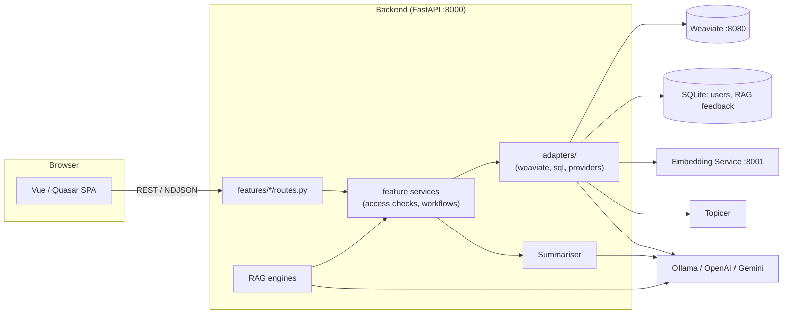

# semANT — Demo Application 

**Quezio** (working name: semANT demo) is a web application for semantic exploration of digitised Czech cultural-heritage texts. It combines full-text, vector and hybrid search over a Weaviate database with LLM-powered summarisation, Retrieval-Augmented Generation (RAG), and AI-assisted text tagging.

> **Project ID:** DH23P03OVV060 (NAKI III programme)
> **Consortium:** Brno University of Technology · Moravian Library · Masaryk University

## Key Features

| Feature | Description |
|---|---|
| **Search** | Hybrid (BM25 + vector), text or vector search over document chunks; metadata and tag filters; optional per-result titles/summaries and an overall summary |
| **Question & RAG chat** | A question answered from the retrieved results, and multi-turn RAG chat with source citations (configurable pipelines, see [ARCHITECTURE](docs/ARCHITECTURE.md#rag-system)) |
| **User collections** | Documents and chunks grouped into collections, shared with other users (shared users annotate, owners manage membership) |
| **Annotations** | Tags and character-level spans (manual `pos`/`neg`, AI-suggested `auto` with reason and confidence) in a document view |
| **AI assistance** | Streamed span suggestions from the external Topicer service and a streamed "discuss this span" chat |
| **App feedback** | In-app feedback form, stored server-side |

## Technology Stack

| Layer | Technology |
|---|---|
| Database | Weaviate 1.40 (Docker) + SQLite (user accounts, RAG answer feedback) |
| Embeddings | Deployed: `Qwen/Qwen3-Embedding-0.6B` on vLLM, queried as an OpenAI-compatible search vector (`configs/search_vectors_qwen.yaml`, the default). `configs/search_vectors_gemma.yaml` targets the former `BAAI/bge-multilingual-gemma2` service (`embedding_service/`); local development uses fakes |
| Backend | Python 3.12 · FastAPI · LangChain / LangGraph · LLM tiers on OpenAI-compatible APIs (OpenRouter by default), Ollama or Google Gemini |
| Frontend | Vue 3 · Quasar 2 · TypeScript · Pinia · OpenAPI-generated client |

## Repository Structure

```
semant-demo/
├── docs/                      # documentation (see the map below); docs/archive/ is historical
├── deploy/                    # Docker Compose files, Dockerfiles, .env templates (deploy/README.md)
├── embedding_service/         # former Gemma embedding service (FastAPI, port 8001); not deployed
├── semant_demo_backend/       # main API server (FastAPI, port 8000)
│   ├── semant_demo/
│   │   ├── main.py            # create_app, routers, lifespan, error mapping
│   │   ├── bootstrap.py       # per-app resources: SQL engine, Weaviate repositories, providers
│   │   ├── config.py          # Config (read once from the environment or a mapping)
│   │   ├── core/              # errors and best-effort write outcomes
│   │   ├── features/          # one package per feature (routes, service, schemas):
│   │   │                      # user_collections, documents, annotations, search, rag,
│   │   │                      # summarization, feedback
│   │   ├── adapters/          # weaviate/, sql/, embeddings/, topicer/, llm/ (the LLM gateway)
│   │   ├── users/             # FastAPI Users (model, manager, JWT) and the user search route
│   │   ├── routes/            # dependency providers and router registration
│   │   ├── configs/           # YAML: LLM model tiers, summariser prompts, search filters, RAG
│   │   └── maintenance/       # reviewed data audits/repairs (docs/DATA_MAINTENANCE.md)
│   └── tests/                 # fast tests; integration/ (real Weaviate)
├── semant_demo_frontend/      # Vue/Quasar SPA
│   └── src/
│       ├── app/               # shell: main layout, right sidebar, session, about/not-found
│       ├── features/          # search, rag, user_collections, documents (incl. viewer/),
│       │                      # annotations, auth, feedback
│       ├── shared/            # api/ transport and guards, ui/, notifications, pagination
│       ├── router/            # routes and the sign-in guard
│       └── generated/         # OpenAPI-generated client (never edit by hand)
├── scripts/                   # throwaway test Weaviate, Python lock helpers
└── weaviate_utils/            # standalone ingestion and inspection scripts (some destructive)
```

## Architecture Overview



See [docs/ARCHITECTURE.md](docs/ARCHITECTURE.md) for the module map, access rules, streaming
behavior and Weaviate/SQL access.

## Getting Started

New to the repository? [Start here](docs/START_HERE.md) explains how the parts fit together, which files to read and how to run tests without project data.

- **Local development**: `make setup`, then `make dev-up`, `make dev-backend` and
  `make dev-frontend` run the application with a seeded synthetic corpus, hot reload and fake AI
  providers; see [docs/DEVELOPMENT.md](docs/DEVELOPMENT.md).
- **Checks** (see [CONTRIBUTING.md](CONTRIBUTING.md#2-setup-and-commands)):

  ```bash
  make check             # Ruff, fast pytest suite, ESLint, vue-tsc, Vitest, API client drift (needs Java)
  make test-integration  # real-Weaviate tests in a throwaway container (Docker)
  make test-e2e          # Playwright smoke suite with fake AI providers (Docker)
  ```

- **Deployment** (Docker Compose stacks, CI/CD, previews): [deploy/README.md](deploy/README.md);
  configuration reference and a manual setup: [docs/DEPLOYMENT.md](docs/DEPLOYMENT.md).
- **API:** the OpenAPI schema is authoritative (`/docs` on a running backend;
  `make api-generate` regenerates the frontend client). Public corpus reads, search without a
  collection, RAG, summaries and questions work anonymously; collection, annotation, AI
  suggestion and span chat routes need a login, and services check resource rights.
- **Models:** every backend LLM call uses a server-owned tier from `configs/llm_models.yaml`
  (`LLM_MODELS_CONFIG`); the shipped tiers use **OpenRouter** and clients never choose a model. See
  [October 2026 model selection](docs/LLM_MODEL_SELECTION_2026-10.md) for prices, expected speed/quality,
  reasoning profiles and current limitations.

## Documentation Map

| Document | Topic |
|---|---|
| [docs/VISION.md](docs/VISION.md) | Project vision, users and roadmap |
| [docs/COLLECTION_ANNOTATION_WORKSPACE_VISION.md](docs/COLLECTION_ANNOTATION_WORKSPACE_VISION.md) | Proposed researcher-facing collection annotation and analysis workspace; early feedback draft |
| [docs/ARCHITECTURE.md](docs/ARCHITECTURE.md) | What runs today: modules, access rules, search, RAG, annotations, frontend |
| [docs/adr/](docs/adr/README.md), [docs/TARGET_ARCHITECTURE.md](docs/TARGET_ARCHITECTURE.md) | Agreed decisions and ongoing design principles |
| [docs/DATABASE.md](docs/DATABASE.md) | Weaviate schema, SQL tables, data ingestion |
| [docs/SEARCH_FILTERS.md](docs/SEARCH_FILTERS.md) | Configurable search filters |
| [docs/RIGHT_SIDEBAR.md](docs/RIGHT_SIDEBAR.md) | Frontend right sidebar and adding page tools to it |
| [docs/START_HERE.md](docs/START_HERE.md) | First steps, code navigation and testing without project data |
| [docs/ISSUE_WORKFLOW.md](docs/ISSUE_WORKFLOW.md) | Draft and implementation-ready issues, consultation, PR handoff and review request |
| [docs/DEVELOPMENT.md](docs/DEVELOPMENT.md) | Local development environment and test stores |
| [docs/DATA_MAINTENANCE.md](docs/DATA_MAINTENANCE.md) | Reviewed data audits and repairs |
| [docs/DB_BENCHMARK.md](docs/DB_BENCHMARK.md) | Read-only Weaviate inventory and query benchmark; [2026-10 production audit](docs/WEAVIATE_AUDIT_2026-10.md) |
| [deploy/README.md](deploy/README.md), [docs/DEPLOYMENT.md](docs/DEPLOYMENT.md) | Docker deployment and CI/CD; configuration reference |
| [docs/OBSERVABILITY.md](docs/OBSERVABILITY.md) | Logs, traces, metrics, dashboards, adding signals safely |
| [docs/TODO.md](docs/TODO.md) | Open risks, linked to GitHub issues |
| [CONTRIBUTING.md](CONTRIBUTING.md), [AGENTS.md](AGENTS.md) | `main`-based PR workflow, checks and agent instructions; [2026-10 agent-readiness audit](docs/AGENT_READINESS_AUDIT_2026-10.md) with measured check times |
| [docs/archive/](docs/archive/README.md) | Historical plans, review notes and maintenance run records |

## Feedback and feature requests

Librarians, researchers and annotators can report problems or suggest
improvements without technical knowledge. See the
[user-feedback issue guide](docs/USER_FEEDBACK_ISSUES.md) for a short explanation
of what helps developers understand a request. Begin the GitHub issue title
with `[User draft]`.

## Contribution Guidelines

Branch from the latest `origin/main`, keep the change focused, include tests and documentation,
and open a pull request into protected `main`. See
[CONTRIBUTING.md](CONTRIBUTING.md#6-branching-review-and-merge) for commands, review
requirements and test selection; [AGENTS.md](AGENTS.md) adds rules for agents.
