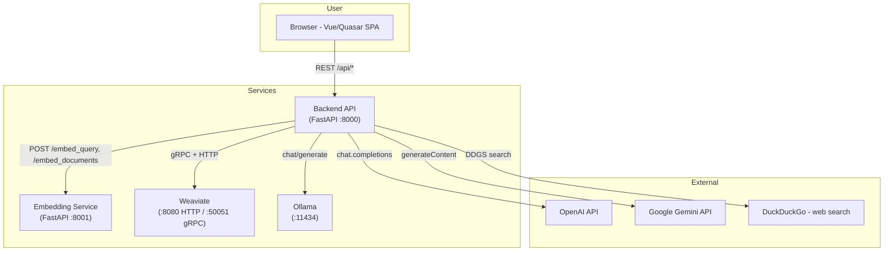
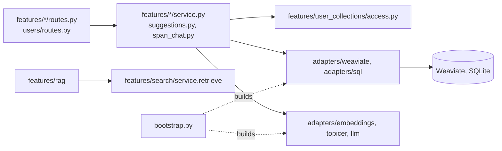
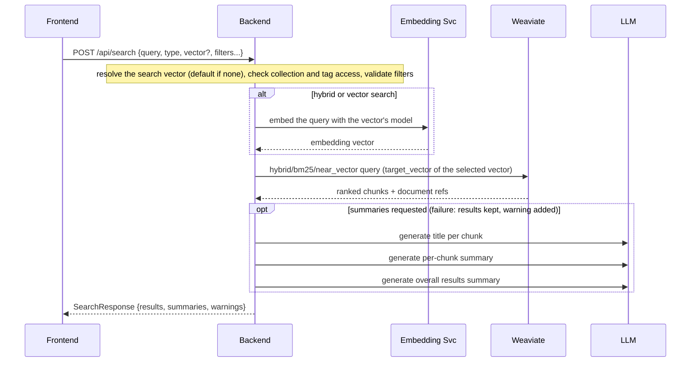
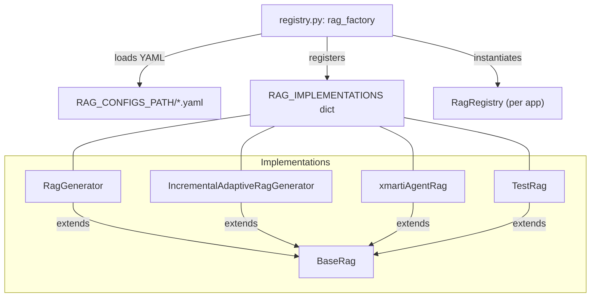
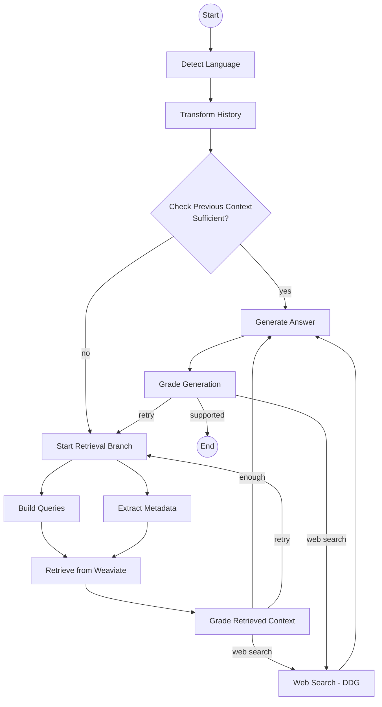

# Architecture

This document describes the implemented application architecture. Ongoing design
principles are in [TARGET_ARCHITECTURE.md](TARGET_ARCHITECTURE.md), adopted
decisions in the [ADRs](adr/README.md), and outstanding work in
[TODO.md](TODO.md). Historical design and delivery records are
[archived](archive/refactor-2026/README.md).

## System Overview

One FastAPI backend and one Vue/Quasar frontend, alongside separately deployed services
(Weaviate, the embedding service, Ollama, Topicer) and external AI APIs:



## Component Details

### 1. Embedding Service (`embedding_service/`)

The **former** embedding service: a FastAPI server wrapping `BAAI/bge-multilingual-gemma2` via `sentence-transformers`. It is no longer deployed. The deployed embedder is `Qwen/Qwen3-Embedding-0.6B` on vLLM (`deploy/docker-compose.embedder.yml`, #385), which the backend queries through an `openai` search vector (`configs/search_vectors_qwen.yaml`, the default; see [Search vectors](#search-pipeline)). `configs/search_vectors_gemma.yaml` and `configs/annotation_vector_gemma.yaml` still target this service.

| Endpoint | Input | Output |
|---|---|---|
| `POST /embed_query` | `{"query": "..."}` | `{"embedding": [float…]}` |
| `POST /embed_documents` | `{"texts": ["...", ...]}` | `{"embeddings": [[float…], ...]}` |

The query endpoint prepends an instruction prefix for asymmetric retrieval. Document embeddings use no prefix.

### 2. Backend API (`semant_demo_backend/`)

The main application server. Built with FastAPI, it handles:

#### Module Map

The backend is one application organized by feature ([ADR 0001](adr/0001-simple-feature-monolith.md)).
Routes parse HTTP and call one service function; services check access and coordinate work;
concrete storage and provider clients live in `adapters/` and are built by `bootstrap.py`.

```text
semant_demo_backend/semant_demo/
  main.py                 create_app, router registration, lifespan, error mapping
  bootstrap.py            AppResources: SQL engine, Weaviate repositories, providers (per app)
  config.py               Config (read once from the environment or an explicit mapping)
  opentelemetry.py        OTLP logs/traces/metrics (off unless OTEL_ENABLED), request logging middleware
  core/errors.py          NotFoundError (404), InvalidRequestError (400), IncompleteWriteError (500)
  core/outcomes.py        WriteResult, StepFailure, WriteOutcome (best-effort multi-write results, ADR 0002)
  features/
    user_collections/     routes, service, access (rights checks, ADR 0007), schemas (incl. CollectionChunk);
                          every collection-scoped route is under /api/user_collections/{collection_id}/...
    documents/            routes, service, schemas (Document, DocumentChunk, DocumentViewChunk, ...):
                          public corpus reads (/api/document(s)/...) and the collection's
                          document view (GET /api/user_collections/{collection_id}/documents/{document_id})
    annotations/          tags and spans (routes, service, offsets, schemas incl. internal AnnotationChunk),
                          derived annotation data (derivation, enrichment, backfill; #328),
                          AI suggestions (suggestions, suggestion_routes), span chat (span_chat, span_chat_routes)
    search/               routes, service, filters, schemas (incl. SearchResultChunk, SummaryRequestBase)
    rag/                  routes, service (answer, explain, answer feedback), registry (BaseRag,
                          class registration, YAML factory), schemas, pipelines/ (RagGenerator,
                          IncrementalAdaptiveRagGenerator, xmartiAgentRag, TestRag), run_demo
    summarization/        routes, service (results summary, question), base and templated
                          (search summarizer), schemas (SummaryResponse)
    feedback/             app feedback: routes, service (feedback log, webhook), schemas
    analytics/            corpus overview: routes, service (counting rules, overview cache), schemas
    quota/                daily LLM allowances: principal (account or guest cookie), service
                          (status, admission, settlement), routes (GET /api/quota), schemas
  adapters/
    weaviate/             one repository per concern: user_collections, documents, tags, spans,
                          chunk_tags, search, analytics (document aggregates); client, paging, writes (best-effort cascades),
                          names (CollectionNames: configured Weaviate collection names)
    sql/                  base (declarative Base), tables (create_tables), users (UserLookup), feedback,
                          quota (QuotaLedger: daily allowance ledger)
    embeddings/gemma.py   embedding service client
    topicer/client.py     Topicer client
    llm/                  the one gateway for backend LLM calls: models (tier catalog and
                          feature policy), gateway (metered LangChain chat models, complete,
                          stream, FeatureChat), usage (token/cost records)
  routes/                 dependencies.py (DI from AppResources), router registration
  configs/                YAML: llm_models, search_summarizer, document_summarizer, search_filters, rag/ (RAG configurations)
  users/                  FastAPI Users: model, manager, auth routers, schemas; routes (user search)
  maintenance/            chunk_tag_audit, metadata_sync (reviewed report and apply, or single-pass sync),
                          document_cleanup (audit, then gated delete of documents without chunks),
                          chunk_year, db_benchmark (read-only Weaviate inventory and query benchmark, #374)
```



Dependencies are one-way: Documents, Search and Annotations use the user collections access
functions; RAG uses Search's authorized retrieval; nothing imports RAG. Summarization reads
Search's schemas; Search calls the summarizer only through its `Summarizer` protocol, which
the search route receives from `get_summarizer`. The document summary (#249) calls
Documents' `read_chunks_in_collection` for access and chunk data instead of a new Weaviate
read. No service reaches
a raw Weaviate or OpenAI client: SDK objects stay inside `adapters/`.

#### Configuration (`config.py`)

A `Config` class that reads settings once, at construction, from the process environment or from an explicit mapping (`Config(environ={...})`, used by tests). `create_app(config)` stores it on `app.state.config`; routes and bootstrap read it through the `get_config` dependency. The process-wide `config` instance is only the entry-point configuration: `semant_demo.main:app`, `run.py` and the standalone scripts (`create_default_configurations.py`, `features/rag/run_demo.py`) read it; application code uses the app's `Config`. Key groups:

- **Weaviate connection** — host, REST port, gRPC port
- **LLM providers** — `OPENAI_API_KEY` / `OPENAI_API_URL` (any OpenAI-compatible endpoint, OpenRouter by default), `OLLAMA_URLS` (only the first is used), `GOOGLE_API_KEY`, and `LLM_MODELS_CONFIG`, the tier catalog (see *LLM gateway* below). There are no per-feature model settings.
- **Application** — port, CORS origin, static file path, `LOG_LEVEL`
- **Observability** — `OTEL_ENABLED` (default off) and the `OTEL_*` / `DEPLOYMENT_ENVIRONMENT` export settings; see [OBSERVABILITY.md](OBSERVABILITY.md)
- **Database** — `SQL_DB_URL` (default `sqlite+aiosqlite:///tasks.db`, relative to the working directory) for user accounts and RAG answer feedback (the file name `tasks.db` is historical; deployments keep it in a mounted host directory together with its rollback journal, so it is kept)
- **Auth** — `JWT_SECRET` (override in production with a long random string); tokens are valid for 7 days (`users/auth.py`)
- **Search vectors** — `SEARCH_VECTORS_CONFIG` (the configured Weaviate named vectors and their query embedding; see *Search vectors* below) and `EMBEDDING_API_KEY` (bearer key of OpenAI-compatible embedding endpoints; empty sends none); `EMBEDDING_SERVICE_HOST` / `_PORT` locate the embedding service
- **RAG** — config directory path
- **Annotation vector** — `ANNOTATION_VECTOR_CONFIG` (default `configs/annotation_vector_qwen.yaml`, empty: none): the contextual vector of span annotations ([below](#annotation-derived-data-328))
- **Annotation tenants** — `ANNOTATION_TENANT_TOUCH_SECONDS` (60), `ANNOTATION_TENANT_IDLE_SECONDS` (3600) and `ANNOTATION_TENANT_DEACTIVATION_ENABLED` (false) for the recorded tenant use and the idle deactivation ([below](#annotation-storage-one-tenant-per-collection-327))
- **AI assistance** — `TOPICER_URL` / `TOPICER_CONFIG_NAME` / `TOPICER_TIMEOUT` for the external Topicer span-proposal service, `TOPICER_MAX_CHUNKS_PER_TAG` (40) and `TOPICER_RESERVE_USD_PER_CHUNK` ($0.005) for its per-tag limit and daily-allowance reservations ([below](#daily-llm-allowances-featuresquota-adapterssqlquotapy)); `SPAN_CHAT_TEMPERATURE`, `SPAN_CHAT_MAX_TOKENS`, `SPAN_CHAT_CONTEXT_CHARS`, `SPAN_CHAT_HISTORY_LIMIT` for the "discuss this span" chat (its model is the `span_chat` tier)

#### Application resources (`bootstrap.py`, `routes/dependencies.py`)

`bootstrap.AppResources` holds the application-scoped resources of one running app. The lifespan creates it, stores it on `app.state.resources`, and closes it at shutdown. At startup it opens the one Weaviate client of the app (`adapters/weaviate/client.connect_weaviate`, which also checks readiness); startup fails if Weaviate cannot be reached. `create_app(config, weaviate_connector=...)` replaces the connector in tests. The dependency functions in `routes/dependencies.py` read from it:

| Dependency | Manages | Lifetime |
|---|---|---|
| `get_config()` | The app's `Config` | App lifetime |
| `get_async_session()` | Database sessions for individual requests | Per-request |
| `get_user_lookup()` | SQL user lookups (`adapters/sql/users.UserLookup`) on a request session | Per-request |
| `get_documents()`, `get_tags()`, `get_user_collections()` | Weaviate repositories (`adapters/weaviate/`) | Startup → shutdown |
| `get_annotation_store()` | The repositories the Annotations service uses (collections, tags, spans, chunk tags, documents), the tenant activity record (`adapters/sql/tenant_activity.TenantActivity`) and the annotation enrichment decided at startup (`AppResources.annotation_enrichment`, #328) | Startup → shutdown |
| `get_corpus_analytics()`, `get_corpus_overview_cache()` | Document aggregates (`adapters/weaviate/analytics.py`); the app's last corpus overview | Startup → shutdown |
| `get_search_backends()` | Search adapter, collection/tag repositories and the configured search vectors (each with its query embedder) for the search service and RAG retrieval | Startup → shutdown |
| `get_search_vectors()` | The configured search vectors (`features/search/vectors.SearchVectors`) | Startup → shutdown |
| `get_topicer()`, `get_span_chat()` | Topicer client; the span chat's `FeatureChat` | Startup → shutdown |
| `get_llm()` | The `LlmGateway` (model tiers, metered chat models) | Startup → shutdown |
| `get_quota_ledger()`, `get_quota_policy()` | The daily LLM allowance ledger (`adapters/sql/quota.QuotaLedger`, short transactions of its own) and the allowance settings | Startup → shutdown |
| `get_summarizer()` | Search result summarization engine | First access → shutdown |
| `get_document_summarizer()` | Whole-document summarization engine (#249) | First access → shutdown |
| `get_rag_registry()` | Configured RAG instances | Startup → shutdown |

Requests that need these resources while the lifespan is not running get HTTP 503.

**Example** (the route only parses HTTP; the service checks access before any read):
```python
@exp_router.get("/api/user_collections/{collection_id}/documents/{document_id}", response_model=DocumentDetail)
async def fetch_collection_document(collection_id: str, document_id: str,
                                    documents: DocumentRepository = Depends(get_documents),
                                    collections: UserCollectionRepository = Depends(get_user_collections),
                                    current_user: User = Depends(current_active_user)) -> DocumentDetail:
    return await service.read_chunks_in_collection(documents, collections, current_user, document_id, collection_id)
```

#### Application Startup & Shutdown

The FastAPI `@asynccontextmanager` lifespan handler orchestrates:

1. **Startup** (`main.py` lifespan):
   - Create `AppResources` (SQLAlchemy engine and session factory, provider clients and the LLM gateway; nothing external is contacted; an invalid tier catalog or invalid quota settings fail startup)
   - Create missing SQL tables (`user`, `rag_user_feedback`, `llm_quota_day`, `llm_quota_operation`, `llm_quota_call`; `adapters/sql/tables.create_tables` never drops or alters existing tables)
   - Open the Weaviate client and build the repositories (startup fails if Weaviate is not ready)
   - Load RAG configurations from YAML and instantiate RAG engines via `rag_factory()` (each gets its chat models from the gateway; a configuration naming a model or an unpermitted tier is skipped with an error log)

2. **Request handling** — dependency injection provides fresh database sessions and reuses long-lived connections (Weaviate, summarizer)

3. **Shutdown** (also after a failed startup):
   - `AppResources.close()` closes the Weaviate client if one was opened, disposes of the database engine, and drops cached resources, so the same app can be started again.
   - When telemetry is enabled, the providers are flushed and the instrumentation removed.

`create_app()` and `app.openapi()` do not connect to Weaviate, SQL, or AI providers; `export_openapi.py` relies on this. With `OTEL_ENABLED=true`, `create_app()` also sets up the process-wide OpenTelemetry providers and exporters (export runs in the background; an unreachable collector does not fail requests), so a process should create one such app.

#### Authentication (`users/`)

User accounts are managed with [FastAPI Users](https://fastapi-users.github.io/fastapi-users/) using JWT Bearer tokens. User records are stored in the SQL database at `SQL_DB_URL` (SQLite by default), next to the RAG feedback table.

| Module | Responsibility |
|---|---|
| `users/models.py` | SQLAlchemy `User` table (on `adapters/sql/base.Base`) — UUID PK, email, hashed password, active/superuser/verified flags, plus `username` (unique, indexed), `name`, `institution` |
| `users/schemas.py` | Pydantic `UserRead` / `UserCreate` / `UserUpdate` schemas (all include the extra fields as optional) |
| `users/manager.py` | `UserManager` — overrides `authenticate()` to accept **email or username** at login; lifecycle hooks (`on_after_register`, etc.) |
| `users/auth.py` | JWT strategy, `FastAPIUsers` instance, exported routers; exports `current_active_user` (mandatory) and `current_active_optional_user` (optional) dependency shortcuts |
| `users/routes.py` | `GET /api/users/search` (signed-in users; username substring of at least 3 characters, at most 4 matches) through `adapters/sql/users.UserLookup` |

**API endpoints:**

| Method | Path | Description |
|---|---|---|
| `POST` | `/api/auth/register` | Create a new account (email, password, username, name, institution) |
| `POST` | `/api/auth/jwt/login` | Login with **email or username** — returns `access_token` |
| `POST` | `/api/auth/jwt/logout` | Logout (client discards token) |
| `GET` | `/api/users/me` | Current user info (requires Bearer token) |
| `PATCH` | `/api/users/me` | Update current user (email / password / name / institution) |
| `GET` | `/api/users/search?q=` | Find users by username substring (for sharing a collection) |

**Route-level authentication:**

Routes authenticate; services authorize ([ADR 0007](adr/0007-access-and-collaboration.md)). Two dependencies are used:

| Dependency | Behaviour | Applied to |
|---|---|---|
| `current_active_user` | Mandatory — returns `401` if no valid token | Collection, tag, span, AI suggestion, span chat, collection-scoped document reads, user search |
| `current_active_optional_user` | Optional — `None` when unauthenticated | Public corpus reads and search, RAG, summaries (these services refuse collection- or tag-scoped requests from anonymous users) |

Resource rights (owner, shared user, admin) are checked by the feature services through
`features/user_collections/access.py`: shared users may read and annotate (spans, tag definitions)
but not change membership, metadata or sharing. Public corpus reads (`GET /api/document/{id}`,
`/api/documents/browse` without a collection, `/api/documents/{id}/chunks/count`,
`/api/documents/{id}/chunks/{chunk_id}/window` and `/adjacent` (a bounded passage around a
chunk and its extension), search
without collection and tags, the corpus overview `/api/analytics/corpus/overview`) need no login. RAG, `/api/summarize/results` and
`/api/question` are public too and call LLM providers with client-supplied text, within the
caller's daily AI allowance (guest or account, [below](#daily-llm-allowances-featuresquota-adapterssqlquotapy)).

The JWT secret is configured via the `JWT_SECRET` environment variable (default is a placeholder — **must be overridden in production**).

#### Search Pipeline



Search supports three modes:
- **hybrid** — combines BM25 text matching and vector similarity (configurable `alpha`)
- **text** — BM25 only
- **vector** — cosine similarity via HNSW index

Optional HyDE (Hypothetical Document Embedding): when `is_hyde=true`, the query is embedded as a document rather than a query, which can improve recall for some use cases.

**Search vectors (#217).** The chunk collection may hold several Weaviate named vectors, created and populated offline (`data_tools/embedder`, #192). `SEARCH_VECTORS_CONFIG` (default `configs/search_vectors_qwen.yaml`) lists those the application may use — an application `id`, a display `name`/`description`, the Weaviate `target_vector` and the query embedding: `embedding_service` (the project's embedding service) or `openai` (an OpenAI-compatible `/embeddings` endpoint, e.g. vLLM, with `model`, optional query/document prefixes and `dimensions`) — and names the `default` (`qwen3-embedding-0.6b`, the deployed Qwen vector; `search_vectors_gemma.yaml` configures the original `default` vector instead). It is validated at startup (an invalid file stops the app); vectors are never discovered from Weaviate. `GET /api/search/vectors` lists the ids, names and descriptions with the default (`default_vector`), no provider details. `SearchRequest.vector` selects one for vector and hybrid search; `null` uses the default, an unknown id answers 400 before any embedding or query (also for text search, which otherwise ignores the selection). `features/search/vectors.py` resolves the selection and the service embeds the query (or the HyDE document) with that vector's embedder (built per vector by `bootstrap.create_embedder`, `adapters/embeddings/`); the Weaviate adapter receives the resolved `ChunkQuery.target_vector` and passes it to every `near_vector`/`hybrid` call, so a collection with several named vectors works; it reads no configuration. `SearchResponse.vector` is the vector used (`null` for text search). The Search page offers the configured vectors in its filter panel when there is more than one and sends no selection for the default.

Filters: configured `filters` (docs/SEARCH_FILTERS.md) or the legacy `min_year`, `max_year`, `language` fields (`min_date`/`max_date` are accepted but not applied; years are matched on the chunks' copy `Chunks.yearIssued`, #153), `user_collection_id`, and tag UUIDs matched as positive and/or automatic chunk tags. A collection needs read access; every tag must belong to a collection the user can read (to `user_collection_id`, if given), otherwise 404 "Tag not found" (401 when anonymous). Without collection and tags, search covers the public corpus, also anonymously. The search feature (`features/search/service.py`) does access, normalization, vector selection, embedding and optional summaries; `adapters/weaviate/search.py` builds and runs the Weaviate query. RAG reuses `service.retrieve` without summaries.

#### Corpus overview (`features/analytics/`, `adapters/weaviate/analytics.py`)

`GET /api/analytics/corpus/overview` (public, #254) counts the documents of the searchable
corpus: the total, documents per publication decade (`Documents.yearIssued`), per source
library (`Documents.library`) and per bibliographic language (`Documents.language`, not the
chunks' language). The response states its `scope` (`searchable_corpus`), `unit`
(`documents`), `computed_at` and `data_source`; it carries counts, not chart specifications.

- **Population.** Every object of `Documents`, as Search covers the whole public corpus;
  `Documents.public` is not used (#279). A future public-read policy must restrict the
  counting query itself, and the cache below must then be kept per scope. Documents without
  chunks are not checked per request: their absence is a maintenance invariant (#281, #313).
- **Counting.** Native aggregates over `Documents` only (never through chunks, never
  objects or vectors): one aggregate reads the total and, per property, the number of
  documents with a value; one grouped aggregate per property reads documents per value (at
  most 10,000 values). Missing values are `total - known` (the deployed collections do not
  index null state, so `is_none` filters fail), and empty or blank values count as unknown.
  Decades are `[start, start + 10)` and run without gaps from the earliest to the latest;
  years that are not whole numbers from 1 to 9999 are unknown. Libraries and languages list
  at most 50 values, with the remaining documents in `other_count`; stored values are
  returned unchanged (the page adds names but keeps the codes). For each available
  dimension, listed counts + `other_count` + `unknown_count` = `total_documents`; counts that
  do not add up (the corpus changed between the queries, or more than 10,000 years) fail
  the request rather than misreport.
- **Unavailable properties.** A property the collection does not declare
  (`missing_property`, e.g. `library` before `metadata_sync`) or that is not a single value
  of the expected type (`unsupported_type`) is `available: false` with `null` counts, never
  zeros; the rest of the overview is still returned.
- **Load and freshness.** Measured on Weaviate 1.34.4 (local Docker, 12 cores): 15 ms for the
  500-document development snapshot; about 1.9 s for 300,000 synthetic documents (the grouped
  aggregates take 0.8–0.9 s each; 20 concurrent computations took 26 s). The app therefore
  keeps its last overview for `CORPUS_OVERVIEW_MAX_AGE` seconds (default 600) and serves it
  again with `data_source: "cached_aggregation"` and the original `computed_at`; concurrent
  requests wait for one computation. Each backend process has its own cache; nothing is
  precomputed or stored, and a failure is not cached (an error response, never an empty
  overview).

#### RAG System

RAG implementations are loaded dynamically from YAML config files via a factory pattern
(`features/rag/registry.py`; the classes are in `features/rag/pipelines/` and register
themselves when the factory imports them). The routes call `features/rag/service.py`, which
picks the configuration (unknown id: 400), retrieves from the public corpus only and stores
answer feedback through `adapters/sql/feedback.py`. `RagRequestMain.vector` selects the search
vector of every retrieval of the answer (`null`: the default; unknown: 400 before the pipeline
runs); the service resolves it and hands the pipeline a retriever bound to it
(`search.service.public_retriever(backends, vector)`), so pipelines contain no vector logic.
Pipeline instances are shared, so they use the retriever passed with each request and never
keep it (the adaptive pipeline passes it to its graph nodes in the run's `configurable`).
The chat page sends no selection yet (the default vector):



**RagGenerator** — Simple single-pass RAG: reformulate question with history → search → generate answer with citations.

**IncrementalAdaptiveRagGenerator** — Current production-ready variant that incrementally expands retrieval, grades context and outputs, and uses fallback search strategies when the initial retrieval is insufficient.

**xmartiAgentRag** — Agentic workflow with tool orchestration (query expansion, decomposition, retrieval quality assessment, evidence synthesis).

**TestRag** — Returns a fixed answer without retrieval or model calls (route tests).

The default `RAG_CONFIGS_PATH` is `configs/rag/demo_configs/` (the configurations offered in the deployed demo). `configs/rag/configs/` holds further loadable variants of the same classes for development and `run_demo`; a test loads both sets, so every shipped configuration names an existing class and a permitted tier.

#### Incremental RAG:


IncrementalAdaptiveRagGenerator is implemented as a `langgraph` state machine. The workflow is:
- detect the question language first, then choose Czech/English prompt templates
- rewrite conversational history into a standalone search question only when history exists
- if the request includes `previous_documents`, optionally reuse them and skip retrieval when a context sufficiency check passes
- otherwise enter an incremental retrieval branch with explicit iteration state:
  - retrieval iteration 0 uses the original query and a small chunk limit
  - retrieval iteration 1 generates multiple query variants for broader coverage
  - retrieval iteration 2 performs a HyDE-style search with the query treated like a document embedding and a higher hybrid alpha
- metadata extraction runs only on the second retrieval iteration when `metadata_extraction_allowed` is true, to infer year/language filters from the question text
- retrieval results are deduplicated and, when enough candidates exist, the returned chunks are graded for relevance before answer generation
- if no relevant documents remain, the router retries retrieval or falls back to DuckDuckGo web search when enabled
- answer generation uses history-aware prompts if conversation history exists
- the generated answer is graded for completeness, and incomplete responses can trigger another retrieval pass or web search fallback

This incremental RAG process is more resilient than a single-pass pipeline: it adapts retrieval strategy based on result quality, tightens search with inferred metadata, and validates both retrieved evidence and the final answer before finishing.

Configurable parameters per RAG config YAML include:
- `tier` — a model tier the `rag` feature allows (default: the feature's default tier); the retired `model_type`, `model_name` and `api_key` are rejected
- `temperature`
- `chunk_limit`, `alpha`, `search_type`
- `max_retries`, `web_search_enabled`, `metadata_extraction_allowed`

#### Summarisation (`features/summarization/`)

Uses Jinja2 templates for prompt construction. Three generation tasks per search:

1. **Title** — short title per chunk, relevant to the query
2. **Query summary** — per-chunk summary of relevance to query
3. **Results summary** — overall summary across all returned chunks

Prompts are in Czech by default (application targets Czech heritage texts). Prompts, fallback texts and per-task options (temperature, context size, maximum tokens) are configurable via `configs/search_summarizer.yaml`; the model is the `search_summary` tier. Clients may send prompts but never a model. A failed summary keeps the results and adds a warning. Titles and per-result summaries are generated for the first `max_generated_results` (10) results only; later results have none and the response carries a warning saying so. All summary calls of one search are one LLM operation (below), admitted against the caller's daily allowance: when it has no room, Search still returns its results, generates no titles or summaries and says so (`warnings` and the structured `quota_exhausted`), never a 429.

`POST /api/question` answers `question_text` from the snippets of `search_response`, both sent in the JSON body (`QuestionRequest`), so the question never appears in a URL that a proxy or access log records (the `question` tier). A failed model call answers 502 with a fixed message, or with the name of the missing provider setting (`LlmNotConfigured`); an input above the `question` feature's limit answers 413 (`LlmInputTooLarge`). The provider's exception text, which may echo the request or endpoint, is neither returned nor logged.

**Document summary (#249)** — `TemplatedDocumentSummarizer` (`features/summarization/document.py`) is a separate class, not a subclass of the search-results summarizer: it has no query, so it does not fit that ABC's `gen_*(query, ...)` contract. `POST /api/user_collections/{collection_id}/documents/{document_id}/summary` (routed here, in `features/summarization/routes.py`, since it owns the LLM-specific summary contract and config, even though the route's URL belongs to the documents resource family) requires collection read access via `features.documents.service.read_chunks_in_collection` — the same check and chunk read the matching `GET` route uses, so a denied request never reaches the model. Chunks are sorted by `order` and truncated to the configured `chunk_limit` (default 40; first N chunks in document order) before being sent to the model, each labelled `[docN]` the same way the search summarizer labels results; the response (`DocumentSummaryResponse`: `document_id`, `summary`, `citations` — chunk id, order, page range — `time_spent`, `total_chunks`, `summarized_chunks`, `truncated`) is self-contained rather than nested in a search-specific type, so a later Document Chat feature (#243, open) can reuse it as context without a second, incompatible summary shape; the truncation fields let the client show a "partial summary" notice for a long document instead of presenting a summary of its first `chunk_limit` chunks as if it covered the whole thing. Prompts, the fallback text, model options and `chunk_limit` are configurable via `configs/document_summarizer.yaml`; the model is the `document_summary` tier. Unlike the search-results summarizer (whose fallback keeps other, successfully-generated results), a document summary has nothing else to fall back on: a failed generation answers 502 (`DocumentSummaryFailed`, the same convention `POST /api/question` uses — a fixed safe message, or the server-authored `LlmNotConfigured` one) rather than 200 with the configured fallback text, so the client never shows a failed generation as a successful summary.

#### LLM gateway (`adapters/llm/`)

Every backend-owned LLM call goes through `LlmGateway` (built by bootstrap, `get_llm()`); Topicer calls its own models and is not metered here (its reported usage is charged to the daily allowance directly, [below](#daily-llm-allowances-featuresquota-adapterssqlquotapy)).

- **Tiers** — `configs/llm_models.yaml` (`LLM_MODELS_CONFIG`) maps `tiny` / `small` / `medium` / `large` to a provider (`openai` — any OpenAI-compatible endpoint —, `ollama` or `google`), a model, an optional endpoint, capabilities (`tools`) and estimated prices. It also lists the tiers each feature may use and its default: `search_summary`, `document_summary`, `question`, `span_chat`, `rag`. Keys and default endpoints come from the environment; the catalog holds no secrets. Clients never choose a model or tier; a RAG configuration chooses a permitted tier server-side.
- **Current deployed model policy (October 2026)** — the shipped `tiny`/`small`/`medium`/`large` tiers are all hosted on OpenRouter through the existing `openai`/OpenAI-compatible adapter, with explicit estimated prices. Each tier may specify an OpenRouter `reasoning` mapping and `supports_temperature: false` to suppress unsupported temperature settings. The mapping is server-side, passed via ChatOpenAI `extra_body`, and leaves user-supplied temperature requests ignored only for tiers that reject them. See [LLM_MODEL_SELECTION_2026-10.md](LLM_MODEL_SELECTION_2026-10.md) for the dated speed/cost/quality review and rationale. The Ollama and direct Google adapter code remains available for alternate deployments, but is not selected by the shipped catalog.
- **Construction** — `chat_model(feature, tier=..., temperature=..., ...)` returns a LangChain chat model (`ChatOpenAI`, `ChatOllama`, `ChatGoogleGenerativeAI`) for the permitted tier, shared by calls with the same options. RAG chains, the LangGraph pipeline and agent tool subcalls use these models unchanged; `complete()` and `stream()` serve the summaries, the question endpoint and span chat (`FeatureChat`). A provider without a key refuses the call before any request is sent (`LlmNotConfigured`).
- **Limits (#397)** — each feature in the catalog has server-side `limits`: `max_output_tokens` caps a call's `max_tokens` (and is its value when the caller sets none; reasoning tokens count against it), `max_input_tokens` refuses a call whose input, estimated at about 4 characters per token, is larger, before anything is sent (`LlmInputTooLarge`, 413), and `max_calls` caps the model calls of one user-visible operation. `LlmGateway.operation(feature)` opens such an operation (a context variable, so LangGraph nodes, parallel grading and agent tool subcalls count too); a call beyond the cap is refused (`LlmOperationLimitExceeded`, 503), and when one of the adaptive RAG's parallel calls fails, the others are cancelled and awaited before the operation ends. Every request-scoped AI use case is an operation (`async with`): search summaries, each RAG answer and Explain, the question, the results summary, the document summary and a span chat reply; an operation is also the unit of the [daily allowance](#daily-llm-allowances-featuresquota-adapterssqlquotapy). Provider requests have a timeout and at most `LLM_MAX_RETRIES` SDK retries. Pipelines keep their own bounds (agent iterations, adaptive-RAG `max_retries`, LangGraph `recursion_limit`, at most 10 graded documents per round); RAG and Explain receive only the last `RAG_HISTORY_LIMIT` history messages. These refusals (`LlmRequestRefused`) have server-authored messages that routes return with their status; user-selected evidence is never truncated silently. The limits bound the work of one operation, not a user's daily usage ([below](#daily-llm-allowances-featuresquota-adapterssqlquotapy)).
- **Usage** — a callback on every model records each call as a structured log line (`LLM call finished`) and, with telemetry, metrics: feature, tier, provider, model, outcome (`success`/`error`/`cancelled`), duration, input/output/total tokens, cost with its `cost_source`, and `request.id`; an operation logs its totals (`LLM operation finished`). Tokens are provider-reported (`usage_source=provider`, also for streams) or, when the provider reports none and for failed or abandoned calls, estimated from text length (`estimated`); unknown usage is never reported as zero. Cost is, in order of preference, the cost OpenRouter reports for the call (`usage.cost`, also in the final chunk of a stream; `cost_source=provider`), the tokens times the tier's list prices (`price`), or for a self-hosted tier with `price_basis: local_rate` its configured USD-equivalent rate (`local_rate`, an accounting rate, not a bill); without a price it is `unknown` and absent, never zero. Records never contain prompts, messages, generated text, snippets or keys. A non-streamed call cancelled by a client disconnect is not recorded (its operation's allowance charge counts it as unfinished, at least the reservation). See [OBSERVABILITY.md](OBSERVABILITY.md#llm-calls).
- **Cost accuracy** — costs are best-effort, not invoice-grade: OpenRouter routes to providers with different rates, list prices change and promotions end, prompt caching discounts, reasoning tokens are billed as output, long prompts may carry surcharges (Haiku 5.5 above 100k tokens), retries inside the SDK are one recorded call, and estimated tokens are rough. The provider account's spending caps remain the hard backstop.

#### Daily LLM allowances (`features/quota/`, `adapters/sql/quota.py`)

A best-effort daily allowance of AI work per visitor (#371), to discourage misuse and show visitors their usage; it is not billing. Amounts are USD-equivalent estimates (the gateway's call costs) stored as integer micro-USD in the SQL database (`SQL_DB_URL`). Provider spending caps remain the hard backstop. Topicer suggestions are counted since #408; offline pipelines and search-vector embeddings are not.

- **Principal** (`principal.get_quota_principal`; `principal.get_allowance_budget` for AI routes) — a signed-in request uses its account (the validated user id), with `LLM_QUOTA_ACCOUNT_DAILY_USD` (default $1.00). Any other request is a guest, identified by the random `semant_guest` cookie the server issues when it is missing or malformed (HttpOnly, SameSite=Lax, path `/api`, `LLM_QUOTA_GUEST_COOKIE_DAYS` = 30 days, `Secure` when `ALLOWED_ORIGIN` is https), with `LLM_QUOTA_GUEST_DAILY_USD` (default $0.25). A newly issued cookie is added to whatever response the request gets — a returned model, a route's own `Response`, a stream, an error or a 429 (`guest_cookie.GuestCookieMiddleware`). The ledger stores only the cookie's SHA-256. Clearing the cookie starts a new guest allowance (accepted); logging in switches to the account's allowance and logging out does not reset the guest's. There are no IP limits or fingerprinting. The allowance values are provisional test defaults, to be tuned from traffic.
- **Day** — a calendar day in UTC; the allowance resets at 00:00 UTC. An operation is booked on its UTC start day, also when it finishes or settles after midnight.
- **Admission** (`service.admit`) — before a user-visible AI operation starts, a bounded upper estimate of its cost is reserved when the day's charged and reserved amounts leave room for it; otherwise `QuotaExhausted` is raised and nothing is reserved. An operation whose estimate exceeds the remaining amount is therefore refused before the allowance is used up, and a used-up allowance refuses every operation, even one with a zero estimate. Admission is one short transaction (a conditional `UPDATE` of the principal's `llm_quota_day` row), so racing requests, connections or workers cannot admit past the allowance; no transaction is held while a model runs.
- **Settlement** (`service.settle`) — once the operation ends, its calls are recorded (`llm_quota_call`: feature, tier, provider, model, outcome, usage and cost source, cost, tokens; no text) and its reservation is replaced by their cost (a negative or non-finite cost is rejected with `ValueError` and nothing is written). An admitted operation may finish even when its cost crosses the allowance; later operations are refused. When a call's cost is unknown (an unpriced tier), the operation is charged at least its reservation, never zero; a self-hosted tier's USD-equivalent `local_rate` cost counts like any other. An operation is settled once. One that is never settled (a crash, a lost callback) keeps its reservation charged on its start day; there is no expiry, recovery job or refund. Rows are kept indefinitely for now.
- **Status** — `GET /api/quota` returns the caller's own allowance only (`QuotaStatusResponse`: principal, day, limit, used = charged + reserved, remaining, `reset_at`, `near_limit` from `LLM_QUOTA_NEAR_LIMIT_RATIO` = 0.8 used, `exhausted`); there is no way to query another principal. It issues the guest cookie when missing. A cross-origin frontend must send credentials for the cookie to be kept; this one does (`credentials: 'include'` on every request, `shared/api/config.ts`), and `ALLOWED_ORIGIN` must name its origin.
- **Refusal contract** — `QuotaExhausted` answers **429** with `QuotaExhaustedResponse` (`detail`, `code: "llm_quota_exhausted"`, `principal`, `reset_at`, `limit_usd`, `used_usd`) and a `Retry-After` header (seconds until the reset). `detail` reads "Insufficient remaining daily AI allowance for this operation; it resets at … UTC.", true both when the allowance is used up and when only the operation's estimate does not fit.
- **Enforcement (#398)** — `LlmGateway.operation(feature, budget)` is the one boundary: with the request's `AllowanceBudget` it admits the operation before its first model call, reserving the feature's `limits.reserve_usd` from the tier catalog (a typical operation, e.g. $0.10 for a RAG answer, $0.005 for a question; not the worst case of `max_calls`), so a refused operation contacts no provider and runs no retrieval, nested RAG calls included. Every gateway call made while it is current — chains, LangGraph nodes, parallel grading, agent tool subcalls — is counted in it; when it ends (also by an error or cancellation) all its finished calls are settled, and a call still running then counts as unfinished with an unknown cost, so the operation is charged at least its reservation. The settlement runs in a task of its own, so a client disconnect does not cancel it; a failed settlement is logged without content and leaves the reservation charged. Nested operations reuse the outer one and are admitted once. Admitted operations are never cut off by the allowance; refusals are not caught by the routes' generic fallbacks.
- **Covered routes** — `POST /api/rag` and `/api/rag/explain` (before the pipeline runs), `/api/question`, `/api/summarize/{summary_type}`, the authenticated document summary `POST /api/user_collections/{collection_id}/documents/{document_id}/summary` (after the access check and chunk read, so a denied request reserves nothing) and the authenticated span chat `POST /api/ai/discuss_span` (admitted after the access check and before the stream starts, settled when the stream ends, before its `done` event) answer a refusal with the 429 below and declare it in OpenAPI. `POST /api/search` admits only when titles or summaries are requested and degrades as described [above](#summarisation-featuressummarization). The Topicer suggestion routes are covered per unit of work (below). Not covered: query embeddings and offline pipelines. A new LLM feature must run its calls in such an operation with the request's budget.
- **Topicer suggestions (#408)** — `POST /api/ai/suggest_spans/{thorough,optimized,selection}` (signed-in accounts only, as before) charge the account's allowance without the gateway (`features/annotations/suggestions.py`, `AllowanceBudget.settle_calls`). Each unit of Topicer work is one operation: a thorough chunk (`topicer_thorough`, reserving `TOPICER_RESERVE_USD_PER_CHUNK`), an optimized tag stream (`topicer_optimized`, reserving it × `TOPICER_MAX_CHUNKS_PER_TAG`) or the selection (`topicer_selection`, it × the selected chunks). The first unit is admitted after the access checks and before the stream starts (a refusal is the 429 above); each later one right before it is sent. A unit is settled when it ends with the provider attempts Topicer reports (`usage` of `/texts`, the `usage_summary` line of `/db/stream`; `reported` cost as `provider`, `estimated` as `price`), also when it found nothing. Usage that is missing because of an error, a cancellation or disconnect (or a `/texts` answer without it, from an older Topicer) counts as unknown, so the unit is charged at least its reservation; only a request Topicer certainly did not process (connection refused, or 422 before inference) is free. A tag stream that ends normally but without a usable `usage_summary` (missing, e.g. an older Topicer, or malformed) is not shown as a failure: it is logged as a `WARNING` and charged a quarter of its reservation (`FALLBACK_SHARE`; $0.05 of the default $0.20), recorded as one `usage_missing` call with `cost_source` `fallback` — an estimate, not reported consumption, without provider, model or tokens. Thorough runs keep at most 10 chunks in flight; a refusal while chunks run waits for one of them to settle and retries, a refusal with none running stops the run. Optimized tags run one after another and a refused tag stops the run. Admitted units always finish and their suggestions stay; the `end` line then has `outcome: partial`, `stop_reason: "quota_exhausted"` with the refusal (`quota_exhausted`) and `units_processed` of `units_total` (`unit` chunk / tag / selection). Nothing resumes after the reset (a rerun duplicates proposals). Settlement runs uninterrupted by a disconnect; a failed one is logged and leaves the reservation charged. Process-wide Topicer concurrency across runs is still open (#227).
- **Frontend (#234, `src/features/quota/`)** — `quotaStore` holds the current principal's status only: `useQuotaScope` (in `App.vue`) follows the guest, or the account once its session is verified (nothing while a stored session awaits verification); signing in, out or into another account, also in another tab, forgets the shown allowance before the next one is read, and answers for an earlier principal are dropped. It is read again after each AI operation (`reportAiOperation` from `shared/api/quota.ts`, called by RAG, the result and document summaries, span chat and AI suggestion runs whatever their outcome) and once when the UTC day rolls over (a timer at `reset_at`); never polled. The header shows the share left (`QuotaIndicator`; its menu: share used, local reset time, whose allowance, Log in/Register for guests); from the near-limit share a dismissible banner (`QuotaBanner`) warns, and says when it is used up — guests get Log in/Register, account users are not asked to register. Shares, not amounts: nothing is billed. A refused operation's 429 is shown as a message with the local reset time (`quotaRefusalOf`, `quotaRefusalMessage`) instead of a generic failure, and is not retried; Search's `quota_exhausted` replaces its warning with an information notice that the results are complete and only AI titles/summaries were skipped. A suggestion run stopped by the allowance says that the remaining allowance is not enough for the next operation (some may remain), how many chunks or tags were processed, how many suggestions were saved and when the allowance resets. A document run asks for confirmation (Cancel / Start tagging) before more than 50 chunk evaluations, and also when its size is unknown because the document stats could not be read or lack the chunk count or per-tag limit.

#### Tags and Tag Spans (`features/annotations/`, `adapters/weaviate/spans.py`, `adapters/weaviate/tags.py`)

`GET /api/user_collections/{id}/tags` lists a collection's tags by name (case-insensitive, then id; #348), because Weaviate returns them in no defined order. The document tags panel puts tags with more annotations first and keeps that order among equals.

Tags can additionally be anchored to specific character ranges inside a chunk: span annotations, stored in the multi-tenant `Annotation` collection ([below](#annotation-storage-one-tenant-per-collection-327)). Three span types coexist:

- `pos` — manually confirmed positive span (created by a human reviewer).
- `neg` — manually rejected span (negative example, useful for AI training/filtering).
- `auto` — AI-proposed span; carries optional `reason` (LLM justification) and `confidence` ∈ `[0, 1]`.

##### Annotation storage: one tenant per collection (#327)

Spans live in one multi-tenant Weaviate collection, `Annotation` (`adapters/weaviate/spans.py`, created by the migration, never by the application). Its tenant is the **user collection's UUID** (`tenant_name`), not a user id: sharing reads and writes the same tenant, renaming or transferring a collection keeps it, and no data is copied. A span keeps its UUID, tag, anchor chunk, UTF-16 offsets and type; `tagId`, `chunkId` and `documentId` are plain UUID properties, filtered directly (Weaviate 1.40 can filter on, but not return, references from a multi-tenant object to a collection without tenants), and a `text_chunk` reference serves only the statistics' "anchor chunk still in the collection" filter. `reason`/`confidence` are part of the schema. The vector config holds an unused `default` (flat index) and the contextual vector of #328 (below).

Every repository method takes the collection whose tenant it uses, and the service passes only a collection it has authorized. Span ids are therefore never credentials: `PATCH`/`DELETE /api/tag_spans/{id}` take a required `collection_id` query parameter, `POST /bulk_update` and `POST /api/ai/discuss_span` a required `collection_id` field, and a span id of another collection is "not found" (also for a user who can read both). Creating a span names its tag, whose collection is the scope; a mixed batch is refused before any write. Nothing scans tenants to locate a span.

Tenants are created lazily by the first span write of a collection (`ensure_tenant`; idempotent in Weaviate, also for concurrent workers, then cached per process — measured ~60–150 ms once per collection and process); reading a collection that has no tenant returns nothing and creates none (a "tenant not found" error is confirmed by a lookup before it is read as empty). A write whose cached tenant was removed meanwhile creates it again. The collection activates inactive tenants on access (`auto_tenant_activation`). Deleting a tag deletes its spans in its collection's tenant (`delete_many`); deleting a collection removes its tenant (step `delete_annotation_tenant`, after its tags) and counts it as removed only when a lookup no longer finds it — Weaviate also acknowledges the removal of a tenant that does not exist.

Idle deactivation: each use of a tenant is recorded in the SQL table `annotation_tenant_activity` (`TenantActivity`, shared by workers and commands): requests touch it at most once per `ANNOTATION_TENANT_TOUCH_SECONDS` per process, AI suggestion runs and the migration hold it "in use" with a heartbeat. `python -m semant_demo.maintenance.annotation_tenants deactivate-idle` deactivates active tenants unused for `ANNOTATION_TENANT_IDLE_SECONDS`; it is refused unless `ANNOTATION_TENANT_DEACTIVATION_ENABLED` — off until the active/inactive backup and restore have been rehearsed on the deployed version (see [DATA_MAINTENANCE.md](DATA_MAINTENANCE.md#annotation-tenants-annotation_tenants-327)). A failed activity write is logged and never fails a request. Startup logs an error when `Annotation` does not exist.

##### Annotation derived data (#328)

Each span also stores derived, searchable data on its `Annotation` object, so concordance (KWIC) rows and similarity search read annotations only, never their source chunks ([DATABASE.md](DATABASE.md#collection-annotation-multi-tenant-327) lists the properties). The anchor chunk, tag and UTF-16 offsets stay authoritative; everything else is derived from them and the document's canonical chunk text (`features/annotations/derivation.py`):

- **Text and context.** `text` is exactly what the offsets select (cross-chunk spans are joined with the canonical ordering; no display normalization). `leftContext`/`rightContext` hold up to `CONTEXT_CHARS` (200) code points around it, not ending inside a word, independent of any display width.
- **Segments and positions.** A document's text is its chunks concatenated in `order`, including chunks outside the collection. A gap in `order` is missing text of unknown length, so positions count from the start of the span's gap-free run (`positionSegment`, the `order` of its first chunk) and are comparable only within one document and segment; no distance is invented across a gap. `documentStartChar`/`EndChar` are UTF-16 units, `documentStartWord`/`EndWord` a half-open word range that includes partially covered words. Words are runs of letters, marks, digits and format characters; whitespace, punctuation (also hyphens and apostrophes) and symbols separate them; a word split only by a chunk boundary is one word. They are not model token counts.
- **Contextual vector.** One named vector (`contextual`, self-provided, flat index per tenant) embeds the configured template — default `{left}<<<{text}>>>{right}`, marking the span within its neighborhood — with the embedder of `ANNOTATION_VECTOR_CONFIG` (`features/annotations/enrichment.py`; default and production: the Qwen embedder, `annotation_vector_qwen.yaml`; the local development and browser-test profiles: the fake embedding service with `annotation_vector_gemma.yaml`). Tag, type and AI metadata are not embedded. The config `id` is stored with each vector; queries use the same model's query embedding.

Writes (`service.py`): a create or an offset change reads the document's chunk texts and stores the span with its derived fields and `revision` (1, then +1 per offset change) in one write, re-derives the chunk tag, then embeds and stores the vector. Type, tag and AI-metadata changes keep the revision and call no embedder. Failures keep the span change: a failed read stores `enrichmentStatus: failed` (step `derive_annotation`), a failed embedding `vectorStatus: failed` (step `embed_annotation`); the write result is `partial` and the document view says what was not updated. Saving the same offsets again re-derives what is not current. A vector is stored only if the span still has the revision it was computed for (checked under a per-span lock, `SpanRepository.lock`, so within one process a late embedding cannot overwrite a newer edit), and derived data counts only for the revision and derivation policy it names (`enrichedRevision`, `derivationVersion`, `vectorRevision`, `vectorConfig`; a vector also only while the text is current, and every re-derivation marks it pending): across processes a stale write is detectable, never trusted. AI suggestion runs count such failures as `enrichment_failures`.

Reads: `service.list_annotation_rows` (a page of a collection's annotations, optionally of some tags or one document, with the document's title and year joined per page; derived fields that are not current are `None`) and `service.similar_annotations` (near-vector search over vectors that are `ready`, of the configured id and of the span's current revision). Both check collection read access first. `list_annotation_rows` (unspecified order) serves the backfill and tests; the concordance reads its rows through `query_annotations` ([below](#concordance-kwic-queries-329)). `similar_annotations` has no HTTP route yet: lexical/semantic/hybrid annotation search is [#332](https://github.com/DCGM/semant-demo/issues/332) within Stage 2 ([#324](https://github.com/DCGM/semant-demo/issues/324)).

The backend writes derived properties only when the collection has them (`bootstrap.detect_enrichment` at startup; otherwise it logs an error and writes spans as before), so Weaviate's auto-schema never adds them. `python -m semant_demo.maintenance.annotation_enrichment` adds them to an existing collection, reports per-tenant counts and backfills incomplete spans in bounded runs, with every backend and other writer of the store stopped ([DATA_MAINTENANCE.md](DATA_MAINTENANCE.md#annotation-derived-data-annotation_enrichment-328)).

##### Concordance (KWIC) queries (#329)

`GET /api/user_collections/{id}/annotations` (`service.query_annotations`, collection read access) returns one page of the collection's annotations as concordance rows (`AnnotationListRow`: id, tag, type, anchor chunk and offsets, revision, `textStatus`, stored `text`/`leftContext`/`rightContext` when current, document title/year/availability) and `total`, the number of all matches. Filters: `tag_id` and `document_id` (repeatable), `type` (default `pos` and `auto`; `neg` only when asked), `q` (each word must occur inside a word of the annotated text, any case: Weaviate `like` on the word-tokenized `text`), `year_from`/`year_to` (documents without a year are left out). `limit` is at most 200. Rows are read from the annotations only, never from chunks.

Every order ends with the annotation id (Weaviate sorts by `_id`), so it is total and pages neither overlap nor skip while the annotations do not change: `document` — document title (missing last, case-insensitive), year, document id, then `positionSegment`, `documentStartChar`, `documentEndChar`; `year` — year (missing last), title, document id, then position; `text` — the annotated text by code point (case-sensitive; rows without current text first). Title and year are not stored on annotations (ADR 0009) and Weaviate cannot sort by a UUID property, so document order and year filters first count the matching annotations per document (one `group_by documentId` aggregation, at most 10,000 documents, otherwise 400) and read those documents' metadata once; the page is then read with at most three queries: documents the page contains entirely in one (partitioned by document, keeping Weaviate's position order) and the documents it cuts at its start and end each with their own offset. Text order without a year filter is one sorted query plus a count. Weaviate does not page beyond 10,000 rows, so a text-ordered page past that (or past it within one document) is refused with 400. `GET .../annotations/documents` lists the annotated documents with their counts for the chosen tags and types, by title (`AnnotatedDocument`; the source and year filters' choices).

The legacy single-tenant `Span` collection (references `tag`, `text_chunk`) is read only by the operator-run migration (`maintenance/annotation_migration.py`) and kept unchanged for rollback.

The Annotations feature (`features/annotations/service.py`) owns tag and span use cases: access checks (read: collection read; spans: annotation edit; tags: tag-definition edit — owner and shared users), offset validation, the span write followed by the chunk tag re-derivation, and partial outcomes. Routes only parse HTTP; `adapters/weaviate/spans.py` and `tags.py` only read and write. AI suggestions (`suggestions.py`, below) save validated proposals and delete suggestions through the same service.

Coordinates (`features/annotations/offsets.py`, frontend twin `src/features/annotations/spanOffsets.ts`, shared cases in `semant_demo_backend/tests/fixtures/text_offsets.json`): a span is stored on the chunk where it starts; `start`/`end` are half-open UTF-16 code-unit offsets (the browser's `String.length`) from the start of that chunk's text. `end` may exceed the chunk: the span continues into the following chunks of the document while their `order` is consecutive, whether or not they are in the collection. Span creation and offset changes are rejected with 400 when `start` is negative or not inside the anchor chunk, the span is empty, it crosses a gap in chunk order, or it ends after the document's text. Changes that do not touch offsets (approve, reject, retag) do not re-check stored offsets.

Tag creation inserts the tag and then links it to its collection; when the link fails the new tag is deleted again and the request fails with 500 (`step: link_collection`; if that deletion fails too, `step: delete_unlinked_tag` and the detail says an unreachable tag may remain). Tag and collection deletion keep 204 on success; when a step fails they answer 500 with `detail`, `step`, `completed` (counts of completed steps) and `uncertain`, keep the completed deletions, and deleting again continues.

REST surface (all under `/api/tag_spans`): `POST`, `GET` (filter by chunk/collection), `POST /batch`, `PATCH /{id}?collection_id=`, `DELETE /{id}?collection_id=`, `POST /bulk_update` (with `collection_id`), `POST /in_document/delete` (delete spans for given tags inside a single document).

Tag-filtered search reads the chunk references `automaticTag` / `positiveTag` / `negativeTag`, not the spans. These references are derived from the spans of the tag's collection tenant: a chunk references tag `T` through the property matching span type `auto` / `pos` / `neg` exactly when at least one such span with tag `T` is anchored on the chunk (a cross-chunk span is anchored on its first chunk; indexing following chunks is deferred to [#224](https://github.com/DCGM/semant-demo/issues/224)). The lists follow the spans' current type: `automaticTag` holds tags with unresolved AI suggestions, so approving a suggestion moves the tag from the chunk's `automaticTag` list to its `positiveTag` list unless another `auto` span of that tag remains. Every span create, update (also offset-only, so saving again retries) and delete (single, bulk, scoped and AI) re-derives the references of the (chunk, tag) pairs it touched (`adapters/weaviate/chunk_tags.py`). Within one process the re-derivation of a pair runs one at a time (`ChunkTagRepository`), so concurrent writes on the same pair end consistent; with several worker processes they can still leave it stale. That second write is best effort: on failure the span write is kept and the response reports a `partial` outcome with an `update_chunk_tags` step. Existing inconsistencies are reported, and corrected only on request, by `python -m semant_demo.maintenance.chunk_tag_audit` (see [DATA_MAINTENANCE.md](DATA_MAINTENANCE.md)).

#### AI Assistance (`features/annotations/suggestions.py`, `suggestion_routes.py`, `span_chat.py`, `span_chat_routes.py`, `adapters/topicer/`, `adapters/llm/`)

External AI integrations that produce or critique spans. All streaming endpoints use NDJSON (`application/x-ndjson`) so the frontend can render partial results incrementally.

**Topicer span proposal.** `adapters/topicer/client.py` (`TopicerClient`, built by bootstrap from `TOPICER_URL` — default `http://topicer:8089` — `TOPICER_CONFIG_NAME`, `TOPICER_TIMEOUT` and `TOPICER_MAX_CHUNKS_PER_TAG`) is an async `httpx` client for the Topicer service. Topicer returns proposed `(tag, start, end, reason, confidence)` per chunk and, since DCGM/topicer#81, the usage of its provider attempts (parsed into `TopicerUsage`; missing or malformed usage is unknown, never zero). Each run is charged to the account's daily AI allowance chunk by chunk, tag by tag or as one selection ([above](#daily-llm-allowances-featuresquota-adapterssqlquotapy)). The workflow (`features/annotations/suggestions.py`) is request-scoped (ADR 0003): a `prepare_*` function checks annotation-edit access and the tag/document/chunk scope and loads tags and chunks before the stream starts (a denied request makes no provider call); iterating the run calls Topicer (at most 10 calls of a run at a time), validates each proposal (its tag must be a requested tag, its chunk a chunk of the document in the collection, its offsets `0 <= start < end <= len(text sent)`, read as code points and stored as UTF-16 units; invalid proposals are rejected, not clamped), saves each valid one as an `auto` span with its chunk tag, and yields a `result` event after the write. The route only encodes events as NDJSON. Each stream ends with an `end` event (`outcome` complete / partial / failed, counts of saved, rejected, failed saves, chunk tag failures and provider failures, units processed of the total, a `stop_reason` and, in optimized mode, `max_chunks_per_tag` and the `tag_limits` reached); a stream without it was interrupted. Failures do not stop the run and nothing is rolled back. On client disconnect the route closes the run: running Topicer calls are cancelled and awaited, a span write in progress finishes first, saved spans remain. Running again stores duplicate `auto` spans for identical proposals (no comparison with stored spans).

| Route | Topicer call | Behaviour |
|---|---|---|
| `POST /api/ai/suggest_spans/thorough` | `POST /v1/tags/propose/texts` (per chunk) | One call per chunk of the document in the collection with all requested tags; one `result` line per chunk in completion order. Slower but resilient to per-chunk failures. |
| `POST /api/ai/suggest_spans/optimized` | `POST /v1/tags/propose/db/stream?max_chunks=<TOPICER_MAX_CHUNKS_PER_TAG>` (per tag) | Topicer pre-filters chunks by vector similarity and streams them; one `result` line per returned chunk, tags one after another. Proposals on chunks outside the collection are rejected. `max_chunks` is backend policy (default 40), never a caller's value; Topicer evaluates at most that many chunks per tag and answers 422 when it exceeds its own `max_chunks_ceiling` (reported as that tag's provider failure, not as success). The terminal `usage_summary` line is never treated as a chunk; a tag that reached the limit is listed in `tag_limits` (`candidates_truncated` when more candidates existed). |
| `POST /api/ai/suggest_spans/selection` | `POST /v1/tags/propose/texts` (once) | The user's selection (UTF-16 offsets over the selected chunks' concatenated text); one `result` line per proposal. Spans are anchored on the chunk where they start; their end counts the document's chunks in between, also those outside the collection. |
| `POST /api/ai/auto_spans/delete` | — | Cleanup endpoint: deletes the `auto` spans of the given tags in one document of the collection. |

Reviewers then approve (`pos`) or reject (`neg`) suggestions through the standard span endpoints.

The AI assist panel asks for confirmation (Cancel / Start tagging) before a document run that may evaluate more than 50 chunks: thorough mode over more than 50 chunks of the document in the collection, optimized mode when the selected tags × `TOPICER_MAX_CHUNKS_PER_TAG` exceed 50. Both numbers come from `GET .../documents/{document_id}/stats` (`chunks_in_collection`, `ai_max_chunks_per_tag`), so the frontend has no copy of the limit. It is a confirmation, not a backend cap. After a run the panel shows which tags reached the limit and says that additional candidates were excluded only when Topicer reported it.

The frontend (`src/features/annotations/useAiAssistance.ts`) reads the stream with `postNdjson` (`src/shared/api/ndjson.ts`), shows saved suggestions as they arrive and reports partial, failed and interrupted runs. Each run carries a token; changing document or collection aborts it and its late events no longer change the store, errors or loading state.

**Span discussion chat.** `features/annotations/span_chat.py` checks read access to the request's `collection_id` and that the span is one of its spans before the stream starts (a denied request reads no context and makes no provider call), then reads the context through the repositories and builds a system prompt around the span — tag definition + examples, host document metadata, the span's text with `<<<SPAN>>>`/`<<<END_SPAN>>>` markers, and a window of surrounding context (`SPAN_CHAT_CONTEXT_CHARS` characters from the same and neighbouring chunks of the document; a cross-chunk span is assembled from the following chunks) — and streams the reply from the `span_chat` model tier (`adapters/llm/gateway.FeatureChat`, built by bootstrap with `SPAN_CHAT_TEMPERATURE`/`SPAN_CHAT_MAX_TOKENS`). The route `POST /api/ai/discuss_span` returns `SpanChatDelta` NDJSON lines ending with `{"done": true}`, or with `{"error": "The assistant reply failed."}` when reading the context or the provider failed after the stream started (only the exception class is logged). Optional context that cannot be read (tag, document, neighbouring chunks) is left out of the prompt. Nothing is stored; the client sends the whole history each turn (the last `SPAN_CHAT_HISTORY_LIMIT` messages are used).

### 3. Frontend (`semant_demo_frontend/`)

Vue 3 + Quasar 2 SPA with TypeScript. Code is grouped by feature under `src/features/`:
each feature owns its pages, components, Pinia stores, composables and repository wrappers
over the generated client. `app/` is the application shell (main layout, right sidebar, session
scope, about and not-found pages), `shared/` holds code without a feature owner (`api/`,
`ui/` buttons and error display, notifications, write outcomes, pagination, color picker,
`visualization/VegaChart.vue`: draws a Vega-Lite or Vega specification with vega-embed,
loaded on demand, fitted to its container width and disposed of on unmount; each redraw is
made in a detached element and only the newest is shown, so overlapping redraws cannot
overwrite one another),
and `router/` the routes and sign-in guard.

| Feature | Contents |
|---|---|
| `search` | search page, result cards, classifications, summary panel, request/summary state |
| `rag` | RAG chat page, the conversation's sources panel and its source registry/selection (`useChatSources`) |
| `user_collections` | collection list, collection workspace and its tabs, collection/share dialogs, `userCollectionsStore`, `collectionStatsStore`, `permissions.ts` |
| `documents` | collection documents table, library browser, `documentsStore`, `chunksStore`, a result's document context (`useChunkContext`), the document view (`viewer/`), document metadata panel, links to the original digitized document (`originalSource.ts`, `OriginalSourceLink`; used by search results, their context, RAG sources and the document view) |
| `annotations` | tags table and dialog, span discussion, annotation/AI-suggestion/tag-navigation composables, `tagsStore`, `tagSpansStore`, span offsets; in the document view: the annotated chunk text, span gutter, selection popover, tags panel and AI assist panel; the collection's annotation workspace (`concordance/`, #329: KWIC table, filters, `concordanceStore`) |
| `auth` | login/register/account dialogs, `userStore`, user search |
| `quota` | the daily AI allowance: `quotaStore`, `useQuotaScope`, header indicator and near-limit/used-up banner ([above](#daily-llm-allowances-featuresquota-adapterssqlquotapy)) |
| `feedback` | feedback page and its schema |
| `analytics` | corpus overview page, its request (`useCorpusOverview`: abort on leave, retry, slow notice), rows/labels/chart specifications (`corpusOverview.ts`) |

The document view (`features/documents/viewer/`) is `DocumentViewLayout` (header; the tags,
AI assist and document tools as panels of the app's right sidebar; loads the document,
collection and tags) around the reader page `DocumentReaderPage`. The reader composes the displayed chunks
(`useChunkWindow`: collection chunks, previews and hidden gap chunks), chunk membership
(`useChunkMembership`), gutter measurement (`useReaderGutters`), the offset helpers
(`readerOffsets.ts`, on top of `annotations/spanOffsets.ts`), and the annotation components
`ChunkAnnotator`, `AnnotationGutter` and `AnnotationPopover`. The panels and the reader share
the annotation, tag navigation and AI suggestion state through their composables.
Components use stores directly (`storeToRefs` for state); composables exist where they add
behavior (AI runs, span discussion, annotation editing, chunk loading, dialogs).

| Route | Page | Description |
|---|---|---|
| `/search` | `search/SearchPage` | Main search interface with filters, results, summaries, a result in its document context |
| `/rag` | `rag/RagPage` | Multi-turn RAG chat with source citations (`[S1]`...); the conversation's sources and one of them in its document in the right sidebar |
| `/corpus` | `analytics/CorpusOverviewPage` | Corpus overview: documents by publication decade, library and language, with tables and unknown/unavailable values (no sign-in) |
| `/collections` | `user_collections/UserCollectionsPage` | List user collections |
| `/collections/:cid/overview` | `user_collections/CollectionOverviewPage` | Collection summary & stats |
| `/collections/:cid/documents` | `user_collections/CollectionDocumentsPage` | Documents inside a collection |
| `/collections/:cid/annotations` | `annotations/concordance/CollectionAnnotationsPage` | The collection's annotations as one aligned line each (KWIC, #329): server-paged, filtered and sorted; checkboxes separate from opening an annotation in its document (right sidebar); filters, page, selection, open annotation and scroll position kept while a document is visited (`concordanceStore`, per collection, cleared on sign-out). *Open in document* links to the document view with `?from=annotations&annotation=&chunk=&order=`: the reader loads up to that chunk and marks the annotation, and its back arrow returns to the workspace |
| `/collections/:cid/tags` | `user_collections/CollectionTagsPage` | Tags scoped to the collection |
| `/collections/:cid/tagging_jobs` | `user_collections/CollectionTaggingJobsPage` | Placeholder page (no behavior; the old tagging jobs were removed) |
| `/collections/:cid/members` | `user_collections/CollectionMembersPage` | Collection sharing / role management |
| `/collections/:cid/documents/:did/v1` | `documents/viewer/DocumentReaderPage` | Document view (text, annotations, AI suggestions, span chat) |
| `/collections/:cid/documents/:did/v2` | — | Redirects to the document view (the retired V2 variant) |
| `/feedback` | `feedback/FeedbackPage` | In-app feedback form |
| `/about` | `app/AboutPage` | Project information |

All network calls go through `src/shared/api`: one backend origin (`BACKEND_URL`), one bearer-token source, credentials (cookies) on every request, the OpenAPI-generated TypeScript client (`src/generated/`, via `useApi()`, used directly or through a feature's repository wrapper) and `postNdjson()` for the NDJSON streams (span suggestions, span discussion), which sends the same token and turns a refused request into an `ApiError` with the backend's `detail`. There is no other HTTP client. State that belongs to a context (collection, document, search, conversation) drops answers that arrive after the context changed (`createContextGuard`/`createScope`); signing out, an expired session or another account clears user-scoped stores (`app/session.ts`) and page state that belongs to the user (account dialog, chat conversation, search results of their collections), and a 401 answer to a request sent with the current token signs the user out locally (expired or revoked session). Availability is not authentication: only a 401 (or an explicit sign-out) ends a session; network errors and 5xx answers never change a verified session's identity, navigation, route, token or user data, the failed operation reports its error. A stored session whose account cannot be read on page load (server unreachable or failing) *awaits verification* (`userStore.awaitingVerification`/`restoreFailed`): neither signed-in nor signed-out navigation, no user data, a layout banner with Retry and Sign out (which ends it locally without a server request), and retries when the tab regains focus or the browser is back online (no polling). A protected link opened meanwhile waits on `/session-pending?redirect=…` and opens once the session is verified; it goes to search if the session ends there or another account's token arrives. A sign-in whose account cannot be read afterwards is dropped and reported as a server problem, not as wrong credentials. Open tabs follow each other through the `auth_token` storage event: a sign-out or another account's token ends the session in every tab, a new token of the same user (signed in again; renewal, #319) keeps it. Ending a session (logout, 401) removes the stored token only while it is still that session's; a restore that fails for another reason ends nothing, the session awaits verification, so a newer token stored by another tab meanwhile survives and is adopted. Only the session is cleared, never other localStorage preferences. Signing out ends the local session at once (token, user and user-scoped state), before and whatever the server answers; the server logout is then sent best effort with the old token named explicitly, so a hanging request never keeps the old session on screen and a late answer cannot touch a newer session. When that request fails the user is told the server did not confirm it (the JWT logout revokes nothing anyway; revocation is #319). The `/collections` routes need a signed-in user (`meta.requiresAuth`, `router/authGuard.ts`): a direct link waits for a stored session to be restored, otherwise goes to search, and signing out on such a route leaves it. The navigation drawer follows the session (Collections, Settings — the account dialog — and Sign out when signed in; Log in and Register otherwise). Back arrows (collection workspace → collection list, document view → collection documents) link to a fixed parent route rather than browser history and never change drawer state; drawer collapse uses the separate neutral `MiniStateButton`. These are UI conveniences; the backend authorizes every request. The app-level right sidebar (`app/sidebar/`) hosts page tools such as the search summary, the document context of a search result and the sources of a chat answer; see [RIGHT_SIDEBAR.md](RIGHT_SIDEBAR.md). Owner-only collection controls are hidden for shared users (`features/user_collections/permissions.ts`, mirroring the backend rules).

### 4. Weaviate + Utilities (repository root `weaviate_utils/`)

Weaviate runs via Docker Compose with persistent storage. Standalone maintenance scripts (not
part of the backend package; several delete or rewrite data — check the endpoint first, see
[DATA_MAINTENANCE.md](DATA_MAINTENANCE.md)):

| Script | Purpose |
|---|---|
| `db_insert_jsonl.py` | Create schema + bulk-insert documents and chunks from JSONL + numpy embeddings |
| `inspect_chunks.py` | Dump chunks (pretty or JSON) |
| `inspect_documents.py` | Dump documents (pretty or JSON) |
| `inspect_all.py` | Inspect all collections |

Document metadata from the Kramerius PostgreSQL mirror is synchronized by the backend
command `python -m semant_demo.maintenance.metadata_sync` (read-only report, then explicit
apply, or a checkpointed single-pass `--sync`; source library only — see
[DATA_MAINTENANCE.md](DATA_MAINTENANCE.md) and [DATABASE.md](DATABASE.md)). Documents without
chunks are audited, and on explicit request deleted, by
`python -m semant_demo.maintenance.document_cleanup` (#281). The document year that the
search filters on is copied to the chunks, and checked, by
`python -m semant_demo.maintenance.chunk_year` (#153).

## Historical material

The old SQL-tracked background tagging tasks (`tagging/`, `Task` model, `/api/tag/task*`
polling) are retired; AI suggestions are request-scoped
([ADR 0003](adr/0003-request-scoped-ai.md)). The [span storage benchmark](archive/TagSpans_benchmark.md)
and `weaviate_benchmarks/` are historical measurements, not a description of current behavior.
