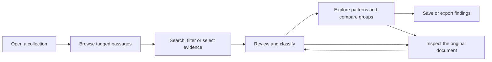

# Exploring and analyzing annotations across a collection

> **Vision for discussion — not a description of currently available features.**
>
> This document describes a proposed semANT workspace from a researcher's point of view. It is intended to invite early feedback from historians, literary scholars, digital humanists, librarians, students, and other prospective users. The ideas below describe the longer-term direction; they are not a promise that every capability will be available in the first release.

## The idea in a minute

Researchers often begin by finding and reading a few relevant historical documents. But many questions require something different: comparing **all the places where a particular theme, expression, person, argument, or other phenomenon occurs** across a collection of documents.

The proposed **Collection Annotation and Analysis Workspace** would make those occurrences the starting point of research. Rather than opening each document separately, researchers could:

- See tagged passages side by side, with enough surrounding words to interpret them.
- Search and narrow those passages by wording, meaning, source, time period, or nearby annotations.
- Review existing tags and AI-suggested passages, and describe them using their own categories.
- Discover possible patterns and alternative groupings, explore them visually, and correct them.
- Ask questions about selected evidence, compare distributions, and export findings with their sources.

The workspace would complement semANT's existing document-reading and tagging experience, not replace it. Every occurrence would remain connected to its original document.

## Why this could be useful

A historian studying newspaper coverage may find hundreds of passages discussing education reform. Reading them one by one makes it difficult to compare how the issue was framed, who spoke about it, and whether the framing changed over time.

A literary scholar might tag passages representing a narrative voice or theme, then discover that seemingly similar passages perform quite different functions. A research assistant might need to review thousands of automatically suggested annotations before those results can be trusted.

These are not simply search problems. They involve **building, checking, comparing, and revising evidence**. The workspace is intended to help with that process while keeping the original texts readily accessible.

## A few terms

| Term | What it means here |
| --- | --- |
| **User collection** | A group of documents or selected parts of documents that a researcher is working with. Collections can also be shared with collaborators. |
| **Tag** | A label for a phenomenon of interest, such as *Political statement*, *Place mentioned*, or *Narrative shift*. |
| **Annotation / occurrence** | One particular passage in a document to which a tag has been applied. A passage may be a word, phrase, sentence, or longer selection. |
| **Attribute** | An additional way to describe an annotation, such as the speaker type, topic, or stance of a statement. |
| **Analysis set** | The particular annotations a researcher has selected or filtered for comparison or AI assistance. |

Tags answer *“Where does this phenomenon occur?”* Attributes help answer *“What kind of occurrence is this?”* Both are defined in the context of the researcher's collection.

## What a research session might look like

Imagine a researcher examining political statements in historical newspapers:

1. They open their collection and choose the tag **Political statement**.
2. A concordance shows all tagged statements together, each with its surrounding text and publication information.
3. They narrow the results to a period and publication, then look for statements occurring near annotations tagged **Criticism**.
4. They define an attribute **speaker type**, with values such as *government*, *local official*, and *other public voice*.
5. They review a selection manually and ask the system to propose values for the remaining statements.
6. They compare those classifications with an alternative grouping discovered automatically.
7. They inspect uncertain cases in the original documents, revise the classifications, and view their distribution by publication and year.
8. They save the useful selection or export the reviewed annotations with context and source references.

This is one possible journey. A researcher could also use the concordance purely for reading and manual comparison, without using AI.

## 1. Read annotations together: the concordance

The central view would resemble a traditional **KWIC concordance** (*Key Word in Context*). Here, the “key” is usually **the passage covered by a tag annotation**, not necessarily a single word.

Each row represents **one annotation**. The tagged passage is visually aligned across rows; preceding text appears on its left and following text on its right. The view uses the space available on screen. There is no separate setting for how many words of context are shown.

For example, a simplified view might look like this:

| Text before | Tagged passage | Text after | Source |
| ---: | :--- | :--- | :--- |
| …the minister insisted that | **the reform was necessary** | for the country's future… | Newspaper A, 1910 |
| …the opposition maintained | **the reform was necessary** | only under certain conditions… | Newspaper B, 1911 |
| …an editorial argued that | **the reform was necessary** | despite public criticism… | Newspaper C, 1913 |

*The text and sources are fictional, included only to illustrate the proposed view.*

A long annotation would still be one row; text that does not fit could be visually shortened. Selecting an occurrence would open its **full document context in the familiar right-hand panel**, highlight the exact annotated passage, and let the researcher inspect or edit it. Returning to the concordance should preserve the current filters, position, and selection.

Annotations with identical text would remain separate occurrences. Researchers could include confirmed annotations, AI proposals awaiting review, or both, and optionally inspect previously rejected proposals.

## 2. Find and select the evidence that matters

Researchers would be able to combine several complementary ways of finding annotations:

- **Word and phrase search:** Find occurrences containing specific wording, or search in the text surrounding the annotation.
- **Search by meaning:** Find passages with similar ideas even when their wording differs.
- **Find similar to this annotation:** Choose an interesting example and inspect other occurrences that resemble it.
- **Research filters:** Narrow results by tag, review status, attribute values, publication, date, author, or other available source information.
- **Sorting:** Arrange results by source, year, annotation text, or words immediately before or after the annotated passage.

### Searching for proximity and co-occurrence

Some questions are about relationships in the original text: *Does a statement appear near criticism? Are references to a person usually followed by references to an institution?*

A researcher could ask for annotations of **Political statement** that occur **within 50 words** of a **Criticism** annotation in the same document. They could specify whether the second annotation should come before, after, or on either side, or look for overlapping or contained passages.

The result would still show **one row per primary annotation**. The nearby occurrence could be inspected as supporting context.

The distance is measured in the source document, **not** by the number of words currently visible on screen. When reliable position information is unavailable, the workspace should say so rather than suggest a false match or non-match.

### Working with selections

Researchers could select individual rows, all rows on a page, or an explicitly identified larger result set. A visible selection count would make clear what an operation will affect.

The **same selection** should be usable when switching between concordance, statistics, clustering, and other analysis views. Opening a source document should not silently change which annotations have been selected.

## 3. Review, correct, and extend annotations

Tags could continue to be assigned manually while reading documents, or proposed automatically across suitable text in the collection.

In the concordance, researchers would be able to:

- Review an AI-suggested occurrence and **accept, reject, edit, or leave it for later**.
- Correct the annotated text boundaries or assign a different tag.
- Review many selected proposals in a controlled sequence, with batch actions where appropriate.
- Ask for additional occurrences of a particular tag to be proposed, including in text not previously annotated.
- Return to the original document whenever the short context is insufficient.

Accepted annotations, unresolved proposals, and rejected suggestions should look clearly different. A rejected suggestion is useful feedback; it should not have to disappear just because the researcher disagreed with it.

AI assistance is meant to accelerate the work, not replace scholarly judgment. The researcher decides which suggestions become accepted annotations.

## 4. Add research-specific attributes

A tag often identifies only the first level of meaning. For example, an annotation tagged **Political statement** might also have:

| Attribute | Example value |
| --- | --- |
| Speaker type | Government |
| Topic | Education reform |
| Stance | Supportive |
| Form | Direct quotation |

Researchers could define their own attributes and possible values, apply them to individual annotations or selections, and revise the definitions as their analysis develops.

Some attributes would allow several values at once—for example, a statement concerning both education and economic policy. It should also be possible to distinguish **not yet classified**, **unknown**, and **not applicable**.

### Assistance with assigning values

After reviewing some examples, researchers could ask the system to propose attribute values for more annotations, or to find occurrences likely to belong to a chosen category.

Different methods may be suitable for different questions: similarity to reviewed examples, classification approaches, or language models interpreting the passage in context. The interface should explain the task and the available choices in terms a researcher can evaluate, rather than requiring expertise in machine learning.

Proposals remain distinguishable from accepted values. Researchers can compare proposed and current assignments, inspect examples and explanations where available, and accept or correct them. Corrections may be used as explicitly chosen examples for subsequent analyses.

## 5. Discover categories that were not defined in advance

A researcher may know which passages are relevant without yet knowing the best way to classify them.

The workspace could suggest **several alternative named groupings** of the same annotations. This resembles topic discovery: one grouping might emphasize subject matter, another rhetorical function, and another types of speakers.

For each proposed grouping, the researcher could explore:

- The suggested group names and descriptions.
- How many annotations belong to each group.
- Representative passages and difficult or ambiguous cases.
- Annotations that do not fit neatly into any group.
- Differences between alternative groupings of the same evidence.

### Explore relationships visually

Alongside the list of groups, researchers could explore a **visual map or graph** of annotations and their relationships. For example, connected points could indicate passages judged similar in meaning. Selecting nodes or groups would select the corresponding annotations in the concordance, where they could be read in context.

Possible visual approaches include similarity graphs, maps, hierarchical groupings, and other displays developed and tested with researchers. No single visualization should be assumed to work for every research question.

A graph is an aid to exploration, **not proof of a historical relationship**. The meaning of connections and visual distances must be explained. Future visualizations might also show where different annotations occur within documents or how frequently they appear near each other.

### Refine rather than merely accept clusters

Researchers should be able to rename groups, combine groups, move annotations between them, create new groups from a selection, and set ambiguous examples aside. More advanced interactive regrouping may become useful as researchers test the workspace.

These exploratory groups would **not automatically become accepted attributes**. Once satisfied, the researcher could preview and deliberately apply a chosen grouping to an attribute.

## 6. Ask questions and check consistency

Researchers could ask questions about a chosen set of annotations, such as:

- *What different arguments appear in these statements about school funding?*
- *How do these occurrences differ between the two publications?*
- *Which examples do not seem to fit our definition of “Government statement”?*
- *Which passages have a stance value inconsistent with similar examples?*

Answers should be grounded in the annotations actually included in the question and provide links back to the supporting passages. If the system worked from a sample rather than the entire selection, that limitation should be visible.

The workspace could also suggest annotations or attribute assignments **worth checking**. Such cases are not automatically errors: apparent inconsistency may reflect a historically meaningful exception, a change of context, or genuine ambiguity.

The aim is to make reviewing large sets more systematic, while leaving final decisions with the researcher.

## 7. Compare and summarize the results

The same selected or filtered annotations could be examined through simple statistics:

- Number of occurrences and number of source documents represented.
- Distributions by tag, attribute value, publication, year, or other available metadata.
- Comparisons between two selected groups of documents or annotations.
- Cross-tabulations—for example, speaker type by topic or period.
- Counts and, when a reliable basis is available, frequencies normalized for different amounts of source text.

Every chart or table should make clear **what was counted**, which annotations were included, and whether the result covers the full filtered set or only a retrieved sample.

Clicking a category or chart element could return to the corresponding concordance rows. More specialized visualizations could be introduced later if they help answer actual research questions.

Analysis would normally stay within one user collection. Comparing statistics from separate collections could be considered later, but categories defined separately might need to be matched before comparisons are meaningful.

## 8. Save, share, and export research work

Not every experiment needs permanent storage. Researchers could explore a temporary grouping, graph, or AI answer within a session and save it only when it becomes useful.

The workspace would distinguish between:

- **A saved view:** Reopen a named set of filters and see annotations that match at that time.
- **A saved selection:** Return to particular identified annotations, even if later filters would find different ones.
- **A saved analysis:** Preserve chosen results, classifications or cluster groupings and enough context to understand how they were obtained.
- **Accepted annotations and attributes:** Keep the reviewed research data independently of whether an exploratory analysis was saved.

Users should be warned before losing substantial unsaved work. A saved analysis should be recognizable as a result from a particular set of evidence, not a timeless answer.

Researchers would also be able to export annotations and selected findings, initially as **CSV or JSON**, including passage text, context, source information, tags, accepted attributes, and available review history. Exports should identify whether they contain all intended results or a limited selection.

Collections already have sharing concepts. Within the proposed workspace, authorized collaborators should be able to work with the same collection evidence, while permissions and the identity of important review decisions remain clear. Real-time simultaneous editing is not assumed.

## 9. Principles for trustworthy research

The following principles should guide the experience across all views:

1. **Source first.** An annotation, classification, chart, or AI answer must remain traceable to its original passage and document.
2. **Researcher in control.** AI-generated suggestions and clusters are proposals until deliberately accepted.
3. **Clear scope.** Every search, question, chart, and batch action should identify which collection, annotations, or selection it covers.
4. **Visible uncertainty.** Missing context, OCR problems, incomplete results, and uncertain classifications must not appear as confident facts.
5. **Revisable interpretations.** Researchers should be able to compare alternatives and correct their coding as their understanding changes.
6. **Useful without AI.** Reading concordances, filtering, reviewing, assigning attributes, counting, and exporting should remain valuable on their own.

## What remains open

This is a vision, not a finalized interface or release specification. The exact layout, choice of visualizations, useful AI approaches, degree of interaction, and balance between session-only and saved analyses should be evaluated with real users.

Some capabilities may arrive gradually. The important aim is a coherent path from **source passages** to **reviewed, interpretable, reusable research evidence**.

## We would value your feedback

You do not need to comment on every feature. In particular, we would welcome responses to questions such as:

1. **What research question would you bring to this workspace?** Which part of the proposed workflow would help most?
2. **How do you currently find and compare occurrences?** What information must be visible in a concordance row, and what can remain in the document context panel?
3. **Which filters or proximity relationships matter in your research?** Are there important relationships beyond word distance and overlap?
4. **How would you define and review categories?** Do you need multiple values, uncertain classifications, or different review procedures?
5. **Would alternative clusterings or a similarity/relationship graph be useful?** What would make them trustworthy, interpretable, or misleading?
6. **What must be saved or exported?** What evidence, source details, and review information do you need for subsequent analysis or publication?

You can share feedback with the semANT project team or contribute to the [feature discussion on GitHub](https://github.com/DCGM/semant-demo/issues/311).

*This document presents a proposed research experience for discussion. Examples, interface sketches, and suggested capabilities may change in response to feedback.*
