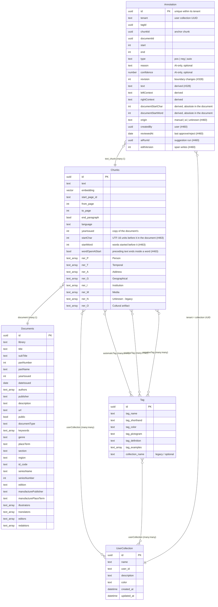

# Database Schema

The application uses two databases:

1. **Weaviate** — primary vector + document store (collections, references, HNSW index)
2. **SQLite** (any SQLAlchemy async URL) — user accounts, RAG answer feedback and the daily LLM allowance ledger

---

## Weaviate Schema



The legacy single-tenant `Span` collection (same span properties; references `tag` → Tag and
`text_chunk` → Chunks) is no longer read by the application; it is the source of the
annotation migration and kept for rollback ([below](#legacy-collection-span)).

### Collection: `Documents`

Stores bibliographic metadata for each digitised document (book, periodical issue, etc.). No vector index — documents are not directly searchable by similarity.

The property list in the diagram above is older than the local development snapshot
(`local_data/`, checked 2026-10-08), which stores `author` (`text[]`), `subtitle`,
`partNumber` (`text`), `url` (`uuid`), `placeOfPublication`, `editors`, `seriesName`,
`seriesNumber` (`text`), `edition`, `illustrators`, `translators`, `redaktors` and has no
`library`, `authors`, `subTitle`, `description`, `keywords`, `genre`, `placeTerm`,
`section`, `region` or `id_code`. The deployed production and shared test stores
(checked 2026-10-24, #496) declare the same `Documents` properties: `library` (`text`, `field`
tokenization), `yearIssued` and `yearIssuedMetadata` (`int`, range index), `dateIssued` and
`dateIssuedMetadata` (`date`, range index), `title` and `language` (`word`); the disposable
dev/test schema (`tests/weaviate_store.py`) declares `library` and `yearIssued` the same way.
The API reads every
store through one model, `features/documents/schemas.Document`: the snapshot's properties plus the
older `library`, `description`, `keywords` (`text[]`), `genre` and `placeTerm`. Properties
a store lacks are absent from the answer; stored properties the model does not name (e.g.
`authors`, `subTitle`, `manufacturePublisher`) are not returned, as before #208.

Key fields:
- `library` — source digital library code (e.g. `"mzk"`, `"nkp"`), as in the Kramerius
  metadata mirror; the API returns it only when stored (no default). With the document id
  (the Kramerius record UUID) and a chunk's `start_page_id` (its first page's UUID) it forms
  the link to the original, `https://www.digitalniknihovna.cz/<library>/view/uuid:<document>?page=uuid:<page>`,
  built in the frontend (`features/documents/originalSource.ts`) only for library codes that
  digitalniknihovna.cz serves (#255)
- `yearIssued` / `dateIssued` — publication year and date; the search filters years on the
  chunks' copy (`Chunks.yearIssued`, below)
- `authors` — array of author names
- `documentType`, `genre`, `keywords` — categorical metadata
- `url` — in the local snapshot (`uuid`) the Kramerius record UUID, equal to the document
  id, not a link; source links are built from `library` and the id (above)
- `public` — whether the document is publicly accessible

#### Document metadata from the Kramerius mirror

`python -m semant_demo.maintenance.metadata_sync` ([DATA_MAINTENANCE](DATA_MAINTENANCE.md#kramerius-metadata-sync-metadata_sync-257))
fills these properties from the `meta_records` row of the document's source library
(`semant_demo/maintenance/kramerius_mapping.py`). MODS values (`metadata_json`) list the
record's own values before its ancestors'; "first" is the first non-empty one, "all" every
distinct value in that order. A field is written only if the collection declares one of
its property names (the first declared one is used) and the value fits the declared type;
otherwise the report lists it as undeclared or skipped.

| Field | Source (same row only) | Property names (current, older) | API (`Document`) |
|---|---|---|---|
| title | the own titles of the row's ancestors in the same library and the row, root first, joined by ". " (e.g. periodical. volume. issue). A level's own title is `title`, else its own MODS `Title`, else (for a part) its own `PartNumber`; a leading repeat of a kept main title is dropped, and pieces within 2 characters of a kept piece (6+ characters; shorter only if equal) or a shortened variant are left out | `title` | yes |
| titleMetadata | first MODS `Title` | `titleMetadata` | no (stored provenance) |
| subtitle | first `Subtitle` | `subtitle`, `subTitle` | `subtitle` |
| partNumber, partName | first `PartNumber`, `PartName` | same (`partNumber` `text` or `int`) | yes |
| dateIssued | day of `date`, else of equal `start_date`/`end_date` (not 1 January), else of MODS `DateIssued`; only when the source names the day and it lies in yearIssued; midnight UTC | `dateIssued` | yes |
| yearIssued | year of `date`, else of `start_date`/`end_date` in one year, else of MODS `DateIssued`; ranges give none | `yearIssued` | yes |
| dateIssuedMetadata, yearIssuedMetadata | MODS `DateIssued` alone | same | no (stored provenance) |
| author | all `Author` | `author`, `authors` | `author` |
| editors, illustrators, translators, redaktors | all `Editor`, `Illustrator`, `Translator`, `Redaktor` | same | yes |
| publisher, language, seriesName, edition | first `Publisher`, `Language` (code as normalized by the MODS parser), `SeriesName`, `Edition` | same | yes |
| seriesNumber | first `SeriesNumber` (text such as "IV" kept) | `seriesNumber` (`text` or `int`) | yes |
| placeOfPublication | first `PlaceTerm` | `placeOfPublication`, `placeTerm` | yes |
| manufacturePublisher, manufacturePlaceTerm | first `ManufacturePublisher`, `ManufacturePlaceTerm` | same | no (stored only) |
| documentType | `record_type` | `documentType` | yes |
| public | `public` of the selected row, always (access matches the source library's record) | `public` | yes |
| library | the selected library (see the source library rule in DATA_MAINTENANCE) | `library` (`text`, field tokenization; added by `--add-library-property`) | yes |

`url` and chunk `language` are not written. `in_library` of the selected row is shown in the
report but does not change anything (the mirror sets it on rows added or updated since the
column was introduced; `false` is not an access or deletion signal). The local snapshot
declares no `library`; applying needs it declared first. In the snapshot (checked
2026-10-10 against the mirror) 237 of 500 documents have mirror rows in one library and
263 in several (207 of them `mzk` + `nkp`); for these the library comes from page evidence, the library
whose row has MODS metadata (`--prefer-library-with-metadata`) or `--library-priority` (DATA_MAINTENANCE).

### Collection: `Chunks`

The core searchable collection. Each chunk is a contiguous text block (typically paragraph-level, may span pages) with:

- **Named vectors** — pre-computed embeddings; the deployed store holds only `Qwen3_Embedding_0_6B` (Qwen/Qwen3-Embedding-0.6B, 1,024 dimensions, #385). The former `default` vector (`BAAI/bge-multilingual-gemma2`) was dropped ([audit](WEAVIATE_AUDIT_2026-10-17.md))
- `text` — the full chunk text (also used for BM25)
- `from_page` / `to_page` — page range in the source document
- `start_page_id` — UUID of the first page
- `ner_*` — named entity arrays extracted by NER (Persons, Temporal, Address, Geographical, Institution, Media, Cultural artifacts)
- classifications (`text[]`, e.g. `communicative_mode`, `style`, `subject_domain`) — written by `data_tools/meta_data_enrichment`; the properties named in `features/search/filters.py::TASK_CLASSES` are search filters and are returned as a hit's `metadata` ([SEARCH_FILTERS](SEARCH_FILTERS.md#5-classifications-on-search-hits))
- `yearIssued` (`int`, filterable with a range index) — a copy of the referenced document's
  `yearIssued`, absent when the document has none; the search's year filters use it, not the
  document reference (#153). It is not maintained by document writes or chunk ingestion:
  `python -m semant_demo.maintenance.chunk_year` declares it, copies the years and checks them
  ([DATA_MAINTENANCE](DATA_MAINTENANCE.md#document-year-on-chunks-chunk_year-153)); keeping it
  current at ingestion is [#313](https://github.com/DCGM/semant-demo/issues/313). The shared
  test store's earlier copy `documentYearIssued` was removed by recreating `Chunks` (#496).
- `order` (`int`) — the chunk's place in its document; a document's orders are consecutive
  (each the previous + 1, the first any integer) and its text is the chunks' `text` concatenated
  in `order` without separators (whatever their collections). A document with a gap or a
  duplicate order violates this model: its annotations are not derived and the position
  backfill reports it.
- `startChar` (`int`), `startWord` (`int`), `wordOpenAtStart` (`boolean`) — where the chunk starts
  in its document's text (#463): the UTF-16 code units of all preceding chunks, the words that
  start in them (one continuing into this chunk included), and whether the last preceding
  character is a word character (letters, marks, digits, format characters). The first chunk
  has 0, 0, false; an empty chunk passes on the state it receives. Example: chunks `"hel"`,
  `"lo world"` have (0, 0, false) and (3, 1, true). Computed only by
  `features/documents/positions.py` and never changed: existing chunks get them from
  `python -m semant_demo.maintenance.chunk_positions`
  ([DATA_MAINTENANCE](DATA_MAINTENANCE.md#chunk-positions-chunk_positions-463)), new chunks in
  the insert that creates them (the append-only import,
  [#313](https://github.com/DCGM/semant-demo/issues/313), which continues from the stored
  tail). Annotation positions are derived from them; they are part of the canonical schema
  of [#128](https://github.com/DCGM/semant-demo/issues/128).

#### References from Chunks

| Reference | Target | Cardinality | Description |
|---|---|---|---|
| `document` | Documents | 1 | Parent document |
| `automaticTag` | Tag | many | Tags of `auto` spans anchored on this chunk (unresolved AI suggestions) |
| `positiveTag` | Tag | many | Tags of `pos` spans anchored on this chunk (approved) |
| `negativeTag` | Tag | many | Tags of `neg` spans anchored on this chunk (rejected) |
| `userCollection` | UserCollection | many | User collections containing this chunk |

The three tag references are what tag-filtered search uses. They are derived from the
`Annotation` collection: a chunk holds a tag reference exactly when at least one span of the
matching type with that tag is anchored on the chunk (its `chunkId`), in the tenant of the
tag's collection. The
lists follow the spans' current type: approving a suggestion (`auto` → `pos`) moves its
tag from `automaticTag` to `positiveTag` unless another `auto` span of that tag remains;
`automaticTag` does not record that the AI once proposed an approved tag. Span
writes maintain this; a reference without such a span is a data inconsistency, not a
supported legacy state (ADR 0004). `python -m semant_demo.maintenance.chunk_tag_audit`
reports inconsistencies.

### Collection: `Tag`

User-defined tags with:
- `tag_name`, `tag_shorthand` — display name and abbreviation
- `tag_color`, `tag_pictogram` — UI presentation
- `tag_definition` — text description used by LLM for tagging
- `tag_examples` — example texts (used in LLM prompt)
- `collection_name` — legacy/optional string in existing data; ownership is primarily modeled via `userCollection` reference

### Collection: `UserCollection`

Named collections of chunks per user:
- `name` — user-provided collection name
- `user_id` — owner identifier
- `description` — optional description
- `color` — UI color identifier
- `created_at`, `updated_at` — timestamps managed by backend

### Collection: `Annotation` (multi-tenant, #327)

Character-level annotations of a tag, one **tenant per user collection**: the tenant name is
the collection's UUID (canonical lowercase form), never a user id. Sharing uses the same
tenant; renaming or changing the owner does not change it. Spans drive the manual
highlighting UI, the AI-assisted tagging workflow and the chunk tag projection. Multi-tenancy:
`auto_tenant_creation` off (the backend creates a tenant on a collection's first span write),
`auto_tenant_activation` on (an inactive tenant is activated by the next read or write).

Properties:
- `tagId` (`UUID`) — the tag; always a tag of the tenant's collection
- `chunkId` (`UUID`) — the anchor chunk, where the span starts
- `documentId` (`UUID`) — the anchor chunk's document (filters of the document view)
- `start` (`INT`) — UTF-16 code-unit offset (inclusive) from the start of the anchor chunk's text
- `end` (`INT`) — offset (exclusive); may exceed the anchor chunk for a cross-chunk span
- `type` (`TEXT`, field tokenization, enum `SpanType`) — one of:
  - `pos` — manual or approved annotation
  - `neg` — rejected suggestion kept as a negative example
  - `auto` — AI proposal awaiting review
- `reason` (`TEXT`, optional) — natural-language justification produced by the AI tagger
- `confidence` (`NUMBER`, optional) — model self-reported confidence in `[0, 1]`

Derived properties (#328, #463; `features/annotations/derivation.py` defines them, the span's own
fields above stay authoritative). Absent on spans saved before #328 until the backfill
([DATA_MAINTENANCE.md](DATA_MAINTENANCE.md#annotation-derived-data-annotation_enrichment-328)):
- `revision` (`INT`) — 1 at creation, +1 on every offset change; absent (= 0) before #328.
  Type, tag and AI metadata changes keep it
- `text` (`TEXT`, searchable) — exactly the canonical text `start`/`end` select, also across chunks
- `leftContext` / `rightContext` (`TEXT`, searchable) — up to 200 code points around the span
  within its document, not ending inside a word
- `documentStartChar` / `documentEndChar` (`INT`, range filters) — half-open UTF-16 offsets from
  the document start (chunks outside the collection count): the anchor's `startChar` plus
  `start` / `end`
- `documentStartWord` / `documentEndWord` (`INT`, range filters) — half-open word range from the
  document start: the words ending at or before the span start, the words starting before its
  end; partially covered words are included
- `positionSegment` (`INT`, legacy) — the `order` where the span's gap-free run of chunks
  started (#328). Neither written nor read since #463; it stays declared on collections that
  have it until a separately approved cleanup. On documents with consecutive orders the
  positions of #328 are the absolute ones, so they were not rewritten
- `enrichmentStatus` (`TEXT`, field: `ready` / `failed` / `invalid`), `enrichedRevision` (`INT`),
  `derivationVersion` (`INT`) — the state of the derived text; it is current only when
  `ready`, `enrichedRevision` equals `revision` and `derivationVersion` is the application's
  `DERIVATION_VERSION`
- `vectorStatus` (`TEXT`, field: `pending` / `ready` / `failed`), `vectorRevision` (`INT`),
  `vectorConfig` (`TEXT`, field) — the state of the contextual vector; it is current only when
  `ready`, `vectorRevision` equals `revision`, `vectorConfig` is the configured id and the
  derived text is current (every re-derivation of the text sets it `pending`)

Provenance properties (#460; written by `features/annotations/service.py`, current state only,
no history). Absent on spans saved before #460: they read as `origin` `unknown`, no actor or
time, version 0, and nothing is invented for them:
- `origin` (`TEXT`, field: `manual` / `ai` / `unknown`) — how the span was created; independent
  of `type` and never changed later (approving an AI proposal keeps `ai`)
- `createdBy` (`UUID`), `createdAt` (`DATE`) — the user who created it (for `ai`: who started
  the suggestion run) and when
- `reviewedBy` (`UUID`), `reviewedAt` (`DATE`) — the last approve or reject (a type change to
  `pos` / `neg`)
- `lastEditedBy` (`UUID`), `lastEditedAt` (`DATE`) — the last span write (type, tag, offsets)
- `aiRunId` (`UUID`) — the suggestion run that proposed it (a UUID per run; there is no run
  table); kept through approval, like `reason` and `confidence`
- `editVersion` (`INT`) — span writes since creation (0 at creation). A write or delete that
  names the version it expects is refused when it differs (HTTP 409, per item `edit_conflict`
  in batches). `revision` keeps counting offset changes only

Attribute properties (#331, [ADR 0011](adr/0011-collection-attributes.md); written by
`features/attributes/service.py`; added on an existing collection by `annotation_attributes
add-schema`). Absent on older annotations: no accepted values, version 0:
- `attributeValues` (`TEXT[]`, whole-element tokenization, filterable, not searchable) — the
  accepted categorical assignments, elements `<attribute id>:<value id>` (canonical lowercase
  UUIDs; `features/annotations/attribute_codec.py`); the authoritative current state, sorted. Only approved
  annotations get values; AI-proposed values are never stored here until a person accepts them
- `attributeVersion` (`INT`) — assignment writes since creation; separate from `editVersion`
  and `revision`, refuses an assignment based on an outdated copy

User ids are stored; the client names them from the collection's owner and members
(`GET /api/user_collections/{id}/people`), anyone else as a former member.

Document metadata (title, year) is not copied onto annotations: reads join it per page of rows.

References:

| Reference | Target | Cardinality | Description |
|---|---|---|---|
| `text_chunk` | Chunks (the collection behind the alias, e.g. `Chunks_test` in production) | 1 | The anchor chunk; only for filters (statistics count spans whose chunk is still in the collection). Weaviate 1.40 does not return references of a multi-tenant object to a collection without tenants. Moving a span to another chunk (#436) replaces it with `reference_replace`; an object update would add the new chunk to the old one. |

Vectors: an unused self-provided `default` named vector (flat index) and the contextual
annotation vector `contextual` (#328, self-provided, flat index per tenant; its name is the
`target_vector` of `ANNOTATION_VECTOR_CONFIG`). On a collection created before #328, the
derived properties and the vector are added by `annotation_enrichment add-schema`
(`config.add_property` / `config.add_vector`, supported on 1.40), and on one created before
#460 the provenance properties by `annotation_provenance add-schema`; the backend writes them
only when they exist (decided at startup), so Weaviate's auto-schema never guesses their types.

The application never creates the collection; the migration does
(`python -m semant_demo.maintenance.annotation_migration backfill --execute`,
[DATA_MAINTENANCE.md](DATA_MAINTENANCE.md#annotation-migration-annotation_migration-327)).

> **Cascades.** Deleting a Tag first removes the chunk tag references to it, then its spans in
> its collection's tenant (`delete_many`), then the Tag. Deleting a collection removes its
> chunk/document links, its tags (with their chunk tag references), then its tenant (all its
> spans at once), then the collection; the tenant counts as removed only when a lookup no
> longer finds it. Done by the backend (`adapters/weaviate/writes.py`), not atomic: a failed
> step keeps the completed deletions and is reported, and deleting again continues.

### Legacy collection: `Span`

The single-tenant span store before #327: `start`, `end`, `type`, `reason`, `confidence`
and the references `tag` → Tag and `text_chunk` → Chunks; a span's collection was its
tag's collection. Only `annotation_migration` reads it; nothing writes it. Keep it until the
migration is verified and the rollback window has passed; removing it is a separate,
reviewed data change.

---

## SQLite Schema

The SQL database (`SQL_DB_URL`, SQLite file `tasks.db` by default — the name is historical)
holds the application tables, declared on `adapters/sql/base.Base` and created at startup by
`adapters/sql/tables.create_tables` when missing: `user` (below), `rag_user_feedback` (likes /
dislikes of RAG answers, `adapters/sql/feedback.py`), the LLM quota ledger (below,
`adapters/sql/quota.py`), `annotation_tenant_activity` (below) and the collection attributes
(`annotation_attribute`, `annotation_attribute_value`, `annotation_attribute_change`, below).
Startup never drops or alters existing tables or rows.

Databases created before the refactor may also contain a `tasks` table from the removed
background tagging jobs. Nothing reads or writes it any more; it is left in place (dropping it
would be a separate, reviewed data change).

### `user` — User accounts (FastAPI Users)

```sql
CREATE TABLE user (
    id              VARCHAR(36)  PRIMARY KEY,   -- UUID
    email           VARCHAR      NOT NULL UNIQUE,
    hashed_password VARCHAR      NOT NULL,
    is_active       BOOLEAN      NOT NULL DEFAULT TRUE,
    is_superuser    BOOLEAN      NOT NULL DEFAULT FALSE,
    is_verified     BOOLEAN      NOT NULL DEFAULT FALSE,
    username        VARCHAR(100) UNIQUE,        -- optional, indexed; accepted at login
    name            VARCHAR(200),               -- display name
    institution     VARCHAR(300)                -- optional affiliation
);
```

Users authenticate with a JWT Bearer token (via FastAPI Users). Login accepts **email or username**. Token lifetime is 7 days; the secret is set via the `JWT_SECRET` environment variable.

### LLM quota ledger — daily AI allowances (#371)

Behavior: [ARCHITECTURE.md](ARCHITECTURE.md#daily-llm-allowances-featuresquota-adapterssqlquotapy).
Amounts are integer micro-USD (1 USD = 1,000,000), USD-equivalent estimates. A principal is
`guest` (id: SHA-256 hex of the guest cookie) or `account` (id: user UUID). Days are UTC
`YYYY-MM-DD`. No row holds prompts, answers or secrets; rows are kept indefinitely for now.

```sql
-- Admission totals; changed only together with an operation, by conditional UPDATEs.
CREATE TABLE llm_quota_day (
    principal_kind      VARCHAR(16),
    principal_id        VARCHAR(64),
    day                 VARCHAR(10),
    reserved_micro_usd  BIGINT NOT NULL,  -- reservations of operations not settled (yet, or ever)
    charged_micro_usd   BIGINT NOT NULL,  -- charges of settled operations
    PRIMARY KEY (principal_kind, principal_id, day)
);

-- One admitted user-visible AI operation, booked on its UTC start day.
CREATE TABLE llm_quota_operation (
    id                  VARCHAR(36) PRIMARY KEY,
    principal_kind      VARCHAR(16) NOT NULL,
    principal_id        VARCHAR(64) NOT NULL,   -- indexed
    day                 VARCHAR(10) NOT NULL,
    feature             VARCHAR(64) NOT NULL,
    status              VARCHAR(16) NOT NULL,   -- pending | settled
    reserved_micro_usd  BIGINT NOT NULL,
    charged_micro_usd   BIGINT,                 -- set at settlement
    unknown_cost_calls  INTEGER,
    started_at          DATETIME NOT NULL,
    settled_at          DATETIME
);

-- The model calls of a settled operation.
CREATE TABLE llm_quota_call (
    id              INTEGER PRIMARY KEY,
    operation_id    VARCHAR(36) NOT NULL REFERENCES llm_quota_operation (id),  -- indexed
    feature, tier, provider, model, outcome, usage_source, cost_source  VARCHAR NOT NULL,
    -- outcome: success | error | cancelled | unfinished (still running when the operation
    -- ended: tier/provider/model empty, cost unknown)
    cost_micro_usd  BIGINT,                     -- NULL when unknown, never 0 for unknown
    input_tokens    INTEGER,
    output_tokens   INTEGER,
    recorded_at     DATETIME
);
```

### `annotation_tenant_activity` — last use of each annotation tenant (#327)

```sql
CREATE TABLE annotation_tenant_activity (
    tenant        VARCHAR(64) PRIMARY KEY,   -- a user collection UUID (the tenant name)
    last_used_at  DATETIME NOT NULL          -- UTC
);
```

Written by the backend at most once per `ANNOTATION_TENANT_TOUCH_SECONDS` per tenant and
process (and by long operations with a heartbeat), read by the idle deactivation
(`maintenance.annotation_tenants`). Advisory: a failed write is logged and never fails a
request. Rows of removed tenants are dropped by the deactivation command.

### Collection attributes (#331)

Definitions and change records of the user-defined categorical attributes
([ADR 0011](adr/0011-collection-attributes.md)); the accepted assignments themselves are on the
annotations in Weaviate (`Annotation.attributeValues`). `adapters/sql/attributes.py`.

```sql
CREATE TABLE annotation_attribute (
    id            VARCHAR(36)  PRIMARY KEY,   -- UUID, stored in assignments
    collection_id VARCHAR(36)  NOT NULL,      -- indexed; the user collection
    name          VARCHAR(200) NOT NULL,
    name_key      VARCHAR(200) NOT NULL,      -- casefolded, trimmed; UNIQUE (collection_id, name_key)
    description   TEXT         NOT NULL,
    cardinality   VARCHAR(8)   NOT NULL,      -- single | multi (immutable)
    tag_ids       JSON         NOT NULL,      -- tags it applies to; [] = all
    retired       BOOLEAN      NOT NULL,
    revision      INTEGER      NOT NULL,      -- +1 per edit of the attribute or its values
    created_by    VARCHAR(36)  NOT NULL,
    created_at    DATETIME     NOT NULL
);
CREATE TABLE annotation_attribute_value (
    id            VARCHAR(36)  PRIMARY KEY,   -- UUID, stored in assignments
    attribute_id  VARCHAR(36)  NOT NULL REFERENCES annotation_attribute (id),  -- indexed
    label         VARCHAR(200) NOT NULL,
    label_key     VARCHAR(200) NOT NULL,      -- UNIQUE (attribute_id, label_key)
    description   TEXT         NOT NULL,
    examples      JSON         NOT NULL,
    kind          VARCHAR(16)  NOT NULL,      -- value | unknown | not_applicable
    retired       BOOLEAN      NOT NULL,
    position      INTEGER      NOT NULL
);
CREATE TABLE annotation_attribute_change (    -- append-only
    id INTEGER PRIMARY KEY, collection_id VARCHAR(36) NOT NULL, annotation_id VARCHAR(36) NOT NULL,
    attribute_id VARCHAR(36) NOT NULL, previous JSON NOT NULL, current JSON NOT NULL,   -- value ids
    actor_id VARCHAR(36) NOT NULL, at DATETIME NOT NULL, source VARCHAR(16) NOT NULL,   -- manual | ai_assisted
    run_id VARCHAR(36), annotation_edit_version INTEGER, attribute_revision INTEGER NOT NULL
);
```

Deleting a collection removes its definitions and records first (best effort, ADR 0002).

---

## Data Ingestion

Data is loaded using `weaviate_utils/db_insert_jsonl.py`:

```bash
python db_insert_jsonl.py \
    --source-dir /path/to/data \
    --delete-old \
    --document-collection Documents \
    --chunk-collection Chunks \
    --tag-collection Tag \
    --usercollection-collection UserCollection
```

Expected input directory structure:
```
source-dir/
├── *.json          # one JSON per document (bibliographic metadata)
├── *.jsonl         # one JSONL per document (one line per chunk)
└── *_embeddings.npy  # numpy array of embeddings matching JSONL line order
```

The script:
1. Scans JSONL files to discover attribute keys
2. Creates Weaviate collections with appropriate data types
3. Inserts documents, then chunks with vector embeddings
4. Establishes `document` references from chunks to their parent documents
