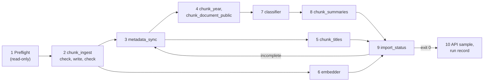

# Appending new data: runbook

A checklist for appending new text chunks to a populated store, from the preflight to the
run's record (#884, #560). It uses only existing commands, each a separate step; nothing here
wraps or schedules them. Each tool's behaviour, options and refusals are in its section of
[DATA_MAINTENANCE.md](DATA_MAINTENANCE.md), linked from every step; this page says in which
order to run them, what to expect and what to check before going on.



An arrow means that a step uses the result of the previous one (the order of
[*Afterwards*](DATA_MAINTENANCE.md#chunk-import-chunk_ingest-313)); `chunk_year` and
`chunk_summaries` must not run alongside another chunk writer, so run the steps one at a time.

## Before you start

- **Authorization.** Writing to the shared test store or production needs explicit
  authorization for that task, and so do the models a run uses (a GPU model, an API model, the
  application's paid tiers). Practise the whole runbook on
  [a copy of the development snapshot](DATA_MAINTENANCE.md#practising-on-a-copy-of-the-development-snapshot)
  first. The [safety rules](DATA_MAINTENANCE.md#safety-rules-all-commands) apply to every step.
- **Working directory.** The backend commands run from `semant_demo_backend/` with the
  repository's `.venv`; the embedder and the classifier from their `data_tools/` directories.
  `HOST:PORT` is the configured `WEAVIATE_HOST:WEAVIATE_REST_PORT`, which the commands print.
- **One name per import.** `CHECKPOINT` below is a new file name for this import (e.g.
  `ingest-2026-12-01.json`), next to which `chunk_ingest` writes `CHECKPOINT.documents.txt`, the
  list that steps 3–9 read. Never reuse a checkpoint name: `chunk_ingest` refuses a new
  checkpoint next to an earlier run's `CHECKPOINT.documents.txt` or manifest (#641).
- **Record as you go.** Keep every report, checkpoint and manifest, and fill in the
  [run record](#run-record) step by step.

Exit codes: 0 done, 1 something is left or was reported (read the summary), 2 refused (nothing
written).

## 1. Preflight (read-only)

| Check | Command or source | Expect |
| --- | --- | --- |
| The target | the endpoint each command prints; the aliases and collections of `Chunks` and `Documents` | the store you are authorized to write |
| Classification status declared | `python -m semant_demo.maintenance.classification_provenance_schema` | exit 0 ([status](DATA_MAINTENANCE.md#chunk-classification-status-classification_provenance_schema-590); production: #832) |
| Stored vectors listed | `python -m semant_demo.maintenance.chunk_have_vector --check have_vector.json` (a full scan) | exit 0 ([`haveVector`](DATA_MAINTENANCE.md#stored-named-vectors-on-chunks-chunk_have_vector-805)) |
| Summary properties declared | `python -m semant_demo.maintenance.chunk_summary_schema` | exit 0 ([summaries](DATA_MAINTENANCE.md#document-chunk-value-summaries-chunk_summary_schema-chunk_summaries-529)) |
| Model configurations | `data_tools/embedder/config.qwen.yaml`, a `chunk_titles` catalog (`configs/chunk_titles_vllm.yaml` or `_ollama.yaml`), `data_tools/meta_data_enrichment/config.yaml` | each config's endpoint and `collection` name the target; the models are the authorized ones |
| Backup | a `backup-filesystem` backup id, or an offline copy | taken now, before the import (rules: #602) |
| No other writers | ingestion, metadata edits, embedder or classifier runs, uploads | none running until step 9 |

## 2. Import (`chunk_ingest`)

[Chunk import](DATA_MAINTENANCE.md#chunk-import-chunk_ingest-313).

```bash
python -m semant_demo.maintenance.chunk_ingest --check CHECKPOINT-check.json INPUT...
python -m semant_demo.maintenance.chunk_ingest --write CHECKPOINT --confirm-endpoint HOST:PORT \
    --backup-id BACKUP INPUT...                                                    # or --offline-backup NOTE
python -m semant_demo.maintenance.chunk_ingest --check CHECKPOINT-after.json INPUT...
```

- **Input:** only the new data, the source files minus what the store already holds. A chunk
  already stored is never written again: a fully stored document is `replayed`, and one whose
  stored chunks differ from the input is rejected (`conflict`). But every input document is read
  from the store, and a write lists `replayed` documents in `CHECKPOINT.documents.txt` too, so
  steps 3–9 would treat them as part of this import. Record the input's source and version in
  the [run record](#run-record).
- **Check:** read the counts (`new`, `append`, `replayed`, `rejected`) and
  `CHECKPOINT-check.json.manifest.jsonl`. Exit 1 means rejected or invalid documents: fix the
  input, or accept that they stay out, before writing.
- **Write:** exit 0, or 1 with `blocked` documents; run the same command again to retry them.
  An interrupted run resumes the same way. The summary gives `CHECKPOINT.documents.txt` and
  its count.
- **Check again** with another new name: expect only `replayed` (rejected documents aside).

## 3. Document metadata (`metadata_sync`)

[Kramerius metadata sync](DATA_MAINTENANCE.md#kramerius-metadata-sync-metadata_sync-257).

```bash
python -m semant_demo.maintenance.metadata_sync --report metadata.json --document-ids CHECKPOINT.documents.txt \
    --infer-library-from-pages --inferred inferred.json                            # read-only
python -m semant_demo.maintenance.metadata_sync --apply metadata.json --confirm-endpoint HOST:PORT
```

- Before `--apply`: check the `unresolved` documents and sample the inferred libraries
  (`inferred.json`). `--apply` refuses unresolved documents unless `--accept-incomplete` is
  given; an unresolved document stays not public.
- Choose the library source by the evidence: `--infer-library-from-pages`, a verified
  `--library-map`, or `--infer-library-from-mirror` for documents without page evidence.
- A second `--apply` with a new report after a successful one exits 1 (nothing eligible).

## 4. Year and visibility on chunks

[`chunk_year`](DATA_MAINTENANCE.md#document-year-on-chunks-chunk_year-153),
[`chunk_document_public`](DATA_MAINTENANCE.md#document-visibility-on-chunks-chunk_document_public-793).

```bash
python -m semant_demo.maintenance.chunk_year --write year.json --confirm-endpoint HOST:PORT        # full scan
python -m semant_demo.maintenance.chunk_document_public --write public.json --confirm-endpoint HOST:PORT \
    --document-ids CHECKPOINT.documents.txt
```

Both after step 3. Until `chunk_document_public` runs, the new chunks are not public and not
searchable. `chunk_year --check year_after.json` must then exit 0.

## 5. Chunk titles (`chunk_titles`)

[Chunk titles](DATA_MAINTENANCE.md#chunk-titles-chunk_titles-575).

```bash
python -m semant_demo.maintenance.chunk_titles --check --models-config semant_demo/configs/chunk_titles_vllm.yaml \
    --documents-from CHECKPOINT.documents.txt
python -m semant_demo.maintenance.chunk_titles --write --confirm-endpoint HOST:PORT \
    --models-config semant_demo/configs/chunk_titles_vllm.yaml --documents-from CHECKPOINT.documents.txt \
    --report titles.json
```

- After step 3 (it uses the document titles). Without `--documents-from` it selects every
  untitled chunk in the store, also outside the import.
- Exit 1 with only `deferred_restricted_document` is expected: the chunks of documents that
  are not public are deferred unless `--include-restricted-documents` is given (only for a model
  that may receive their text). Any other reason: run `--write` again.

## 6. Vectors (`data_tools/embedder`)

[Embedder](DATA_MAINTENANCE.md#chunk-import-chunk_ingest-313) (*Afterwards* step 4),
[README](../data_tools/embedder/README.md).

```bash
cd data_tools/embedder
python run.py config.qwen.yaml --check                                  # exit 1: vectors to compute
python run.py config.qwen.yaml --confirm-endpoint HOST:PORT
python run.py config.qwen.yaml --check                                  # expect exit 0
```

It selects the chunks whose `haveVector` lacks the vector's name, whichever import added them.
Until it runs, the new chunks are missing from vector and hybrid search.

## 7. Classification (`data_tools/meta_data_enrichment`)

[Chunk classification](DATA_MAINTENANCE.md#chunk-classification-data_toolsmeta_data_enrichment-590).

```bash
cd data_tools/meta_data_enrichment
python run.py config.yaml --check                                       # chunks still UNPROCESSED
python run.py config.yaml --confirm-endpoint HOST:PORT
python run.py config.yaml --check                                       # expect none selected
```

- After step 4: an API model without `include_restricted_documents` selects only public
  chunks, and the import created every new chunk not public.
- A local model also classifies the chunks of documents that are not public. An API model
  leaves them `UNPROCESSED`, and its check does not count them (it counts what a run would
  select); step 9 reports them. Keep the run summary (the model's fingerprint) for the record.

## 8. Document summaries (`chunk_summaries`)

[Summaries](DATA_MAINTENANCE.md#document-chunk-value-summaries-chunk_summary_schema-chunk_summaries-529).

```bash
python -m semant_demo.maintenance.chunk_summaries --write summaries.json --confirm-endpoint HOST:PORT
python -m semant_demo.maintenance.chunk_summaries --dry-run summaries_after.json      # expect exit 0
```

The final write, after step 7: it summarizes the chunks' classifications. A full-corpus pass.

## 9. Final check (`import_status`)

[Import status](DATA_MAINTENANCE.md#import-status-import_status-884).

```bash
python -m semant_demo.maintenance.import_status --report status.json --document-ids CHECKPOINT.documents.txt \
    [--titles-included-restricted] [--classifier-skipped-restricted]
```

Give the options that match how steps 5 and 7 ran; the command cannot tell:

| Steps 5 and 7 ran with | Options |
| --- | --- |
| `chunk_titles` without `--include-restricted-documents`, a local classifier model | none |
| `chunk_titles --include-restricted-documents` | `--titles-included-restricted` |
| an API classifier model without `include_restricted_documents` | `--classifier-skipped-restricted` |

- **Exit 0:** every stage reached the listed documents (expected gaps aside) and the index
  found every sampled chunk. Go on to step 10.
- **Exit 1, a stage incomplete:** `stages.STAGE.incomplete_ids` names the documents or chunks
  and the reasons. Run that stage's step again, then the steps after it (e.g. new titles change
  nothing downstream, a new classification needs step 8 again), then this report with a new
  file name.
- **Exit 1, index misses** (`index.missed_ids`): `no_stored_vector` means the embedder listed a
  vector it did not store (run step 6 again). `not_in_top_k` is a *self-retrieval miss*, not
  proof of a missing index entry: right after step 6 the vector may still be queued for
  indexing, and many chunks with an identical vector can crowd a correctly indexed chunk out of
  the top K. Run the report again later; if the same chunks still miss, record them and
  investigate (e.g. their duplicates) before treating the import as complete.
- **Exit 2:** refused before reading the chunks; the message says why.

## 10. Through the API, and the record

Read a few new documents through the API the way users do, anonymously, without generated
titles or summaries (which would call a model). `API` is the semant-demo backend the web app
calls: the deployment's `BACKEND_URL` (requests go to `BACKEND_URL/api/...`,
[DEPLOYMENT.md](DEPLOYMENT.md#frontend-environment); `http://localhost:8000` locally). `DOC` a new
public document of the list, `HIDDEN` an unresolved or restricted one, `YEAR` and `LANG` the
year and chunk language of `DOC`, `PHRASE` a few words from one of its chunks.

```bash
curl -s "$API/api/document/$DOC"                                        # 200, with its title, year, public
curl -s -o /dev/null -w '%{http_code}\n' "$API/api/document/$HIDDEN"    # 404: not readable anonymously
NOGEN='"search_title_generate":false,"search_summary_generate":false,"search_results_summary_generate":false'
for type in text vector hybrid; do
  curl -s -X POST "$API/api/search" -H 'Content-Type: application/json' \
    -d "{\"query\":\"$PHRASE\",\"type\":\"$type\",\"limit\":10,$NOGEN}"
done                                                                     # DOC among results[].document
curl -s -X POST "$API/api/search/documents" -H 'Content-Type: application/json' \
  -d "{\"criteria\":{\"document_filters\":{\"year_min\":$YEAR,\"year_max\":$YEAR},\"chunk_filters\":{\"languages\":[\"$LANG\"]}}}"
                                                                         # DOC among items[].document.id
```

`HIDDEN` must not appear in any search either. If `DOC` is missing from vector or hybrid
search only, check step 6; from the document search with a chunk filter, step 8.

### Run record

Post it on the issue of the import (not in these docs), with the reports attached or linked:

```markdown
**Import run:** INPUT (files, size, source and version) → TARGET (endpoint, collections), by WHO, DATE

- Authorization: link
- Backup: id or offline copy note
- Models: embedder (config, model), chunk_titles (catalog, model, prompt hash), classifier (config, provenance, fingerprint)

| Step | Command (mode) | Exit | Counts | Notes |
| --- | --- | --- | --- | --- |
| 2 chunk_ingest | check / write / check | | new, append, replayed, rejected, blocked; documents listed | |
| 3 metadata_sync | report / apply | | resolved, unresolved, libraries inferred | |
| 4 chunk_year, chunk_document_public | write | | chunks updated | |
| 5 chunk_titles | write | | titled, deferred, failed | |
| 6 embedder | check / run / check | | embedded, empty inputs | |
| 7 classifier | check / run / check | | classified, left UNPROCESSED | |
| 8 chunk_summaries | write / dry-run | | documents updated | |
| 9 import_status | report | | incomplete per stage, gaps, index sampled / missed | |
| 10 API sample | | | documents checked | |

- Failures and their handling:
- Remaining work (with issues):
```

## After an interruption

Every step can be run again; none needs cleaning up first.

| Step | Running it again |
| --- | --- |
| 2 `chunk_ingest --write` | the same command with the same `CHECKPOINT` resumes and retries `blocked` documents |
| 3 `metadata_sync --apply` | writes only where the stored values still equal the report's; a new `--report` plans the rest |
| 4 `chunk_year`, `chunk_document_public` | the same command with the same file resumes the checkpoint and retries its failed writes; a finished checkpoint is refused, so a new pass takes a new name. Only differing chunks are written |
| 5 `chunk_titles` | selects the chunks still untitled (no checkpoint) |
| 6 embedder | selects the chunks still without the vector |
| 7 classifier | selects the chunks still `UNPROCESSED` |
| 8 `chunk_summaries` | run it again with a new report: it recomputes every document's summaries |
| 9 `import_status` | read-only; a new report file name |
